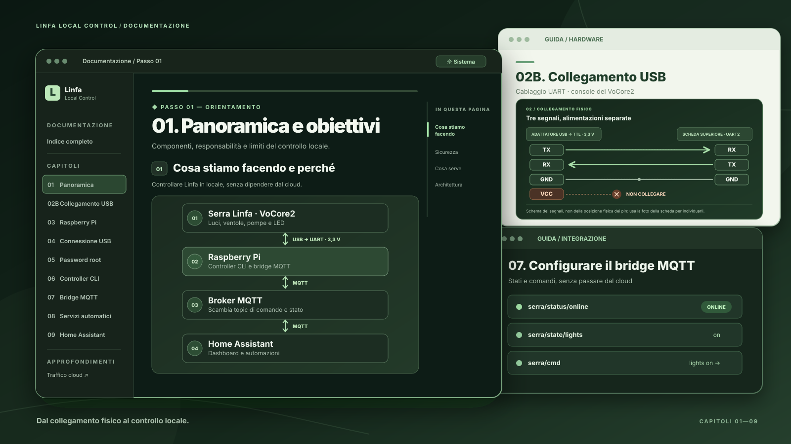
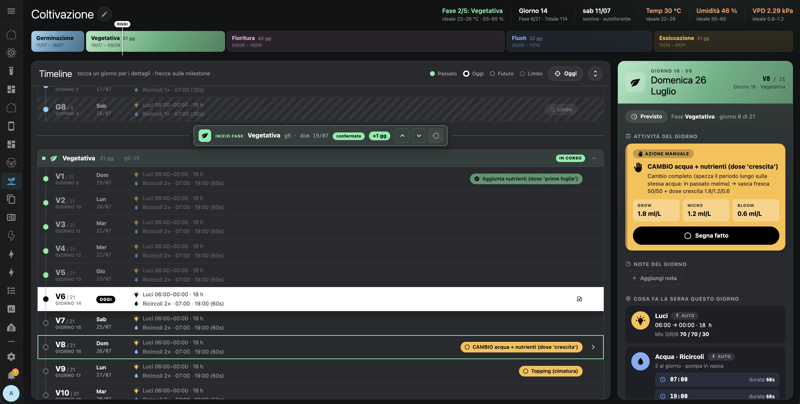

# Linfa Local Control

> **English:** The documentation is currently in Italian because Linfa is an Italian product. If an English translation would help you, [open an issue](https://github.com/Interstellar0verdrive/Linfa-local-control/issues/new) or get in touch; I'm happy to translate it if there's interest.

**Una serra Linfa, sotto il tuo controllo.** Questo progetto collega la serra a un Raspberry Pi tramite cavo USB seriale oppure Wi-Fi locale e porta comandi e stati su MQTT, per usarla con Home Assistant senza dipendere dal cloud per il normale funzionamento.

La procedura è stata provata su **Linfa Weezy**. Potrebbe funzionare anche sulla Linfa standard, ma questa variante non è ancora stata verificata.

[**Apri la guida passo per passo →**](https://interstellar0verdrive.github.io/Linfa-local-control/) · [Esplora il controller](bridge/) · [App Home Assistant](app/DOCS.md)

## La guida

La [documentazione navigabile](https://interstellar0verdrive.github.io/Linfa-local-control/) è organizzata in **nove passi, numerati da 01 a 09**. Al passo 02 puoi [provare il Wi-Fi](https://interstellar0verdrive.github.io/Linfa-local-control/setup/02-wifi/) oppure [scegliere il cavo USB](https://interstellar0verdrive.github.io/Linfa-local-control/setup/02-hardware/); dal Raspberry in poi il percorso torna comune. Ogni passo termina con una verifica e il collegamento al successivo.

Chi vuole replicare il setup può seguire direttamente questo percorso. L'analisi del traffico cloud, il dump del VoCore e le modifiche facoltative alla configurazione originale sono raccolti negli **approfondimenti**.

Il [controllo via Wi-Fi/SSH](https://interstellar0verdrive.github.io/Linfa-local-control/approfondimenti/percorso-wifi-sperimentale/) è stato provato su una serra **già modificata**, anche dopo il riavvio. L'accesso SSH iniziale a una serra mai modificata **non è verificato**: se non riesce, la guida porta al collegamento USB, che puoi mantenere anche a regime.

**Prima dei test sui componenti:** verifica il servizio originale `robocontrol/rcc`. I due sistemi non sono stati provati in funzione contemporaneamente. Il [passo 06](https://interstellar0verdrive.github.io/Linfa-local-control/setup/06-controller-cli/#verifica-del-servizio-originale) contiene il controllo, la disattivazione reversibile e la verifica dopo il riavvio. La sequenza è stata ricostruita sui file del prototipo, ma non ancora provata da zero su una seconda serra.

La [tabella dei comandi](https://interstellar0verdrive.github.io/Linfa-local-control/riferimento-comandi/) mette affiancati i comandi del Raspberry e i payload MQTT equivalenti per Home Assistant.

## Stato del progetto

| Componente | Stato |
| --- | --- |
| Guida hardware e setup | **Pubblicata** — [inizia dal capitolo 01](https://interstellar0verdrive.github.io/Linfa-local-control/setup/01-panoramica/) |
| Controller CLI e bridge MQTT | **Disponibili** nella cartella [`bridge/`](bridge/) |
| App completa per Home Assistant | **Versione sperimentale** nella cartella [`app/`](app/). Include l'interfaccia e il piano di coltivazione completo con varianti autofiorente e fotoperiodica. Leggi le [istruzioni di installazione](app/DOCS.md) prima di usarla. |

### Anteprima dell'app Home Assistant

*Vista Coltivazione della versione sperimentale. L'interfaccia potrà cambiare.*

Il controller usa la shell del VoCore2 via seriale oppure SSH locale; il Raspberry fa da ponte con MQTT. Gli stati pubblicati rappresentano soprattutto l'**ultimo stato logico noto**, non una misura hardware sempre affidabile. Il [file di configurazione di esempio](bridge/serra-mqtt.env.example) mostra come scegliere il trasporto sul proprio Raspberry.

## Prima di intervenire

> [!WARNING]
> **Progetto indipendente e non ufficiale.** Questo repository non è affiliato, approvato, sponsorizzato o supportato da Robonica S.r.l. I nomi Linfa e Weezy servono solo a identificare i prodotti trattati.
>
> Aprire e modificare la serra può causare malfunzionamenti e **potrebbe far decadere la garanzia commerciale**. Verifica le condizioni applicabili prima di intervenire; i diritti della garanzia legale sono distinti dalla garanzia commerciale.

> [!CAUTION]
> **Scollega la serra dalla presa e l'adattatore USB → TTL dal Raspberry/computer** prima di aprire la scocca, toccare o collegare i pin, saldare o forare. Tieni l'elettronica lontana da acqua, serbatoi, tubi e pompe. La guida presuppone esperienza di base con collegamenti elettrici e saldature: se hai dubbi sulla sicurezza, fermati e chiedi aiuto a una persona qualificata. Leggi le [precauzioni complete](https://interstellar0verdrive.github.io/Linfa-local-control/setup/01-panoramica/#prima-di-intervenire-sicurezza-elettrica-e-acqua).

## Licenza

Il codice e i contenuti originali della repository sono distribuiti con [licenza MIT](LICENSE). I nomi e i marchi Robonica, Linfa e Weezy restano dei rispettivi titolari. Le immagini delle guide dell'app nella cartella [`app/`](app/) non sono comprese nella licenza MIT; i diritti restano ai rispettivi titolari.
