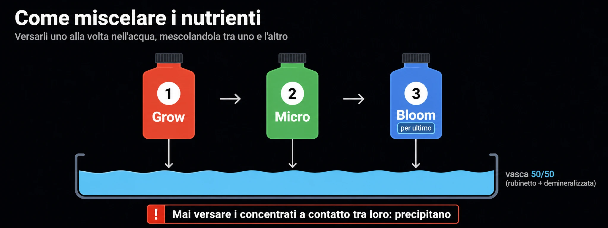
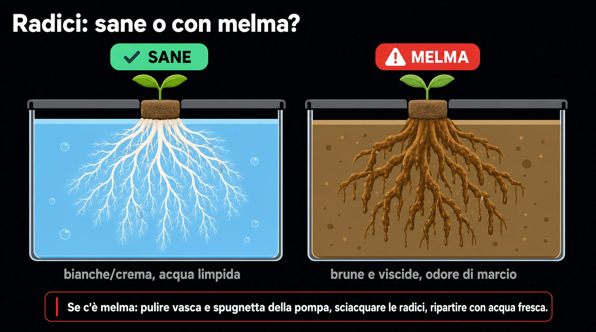

# Cambio acqua e nutrienti
> La manutenzione che tiene in salute la vasca

In idroponica la soluzione nutritiva è "il terreno" della pianta: cambiarla con
regolarità evita accumuli di sali, sbalzi di pH e formazione di melma. Questa è
la procedura del cambio completo.

## L'acqua di base

- **50/50** rubinetto + demineralizzata: abbassa durezza e sali di partenza,
  lasciando comunque un minimo di calcio e magnesio.
- A temperatura ambiente (~18-21 °C): l'acqua fredda stressa le radici, quella
  troppo calda trattiene meno ossigeno.

## L'ordine di miscelazione

- Aggiungere i nutrienti **uno alla volta** nell'acqua, mescolando tra uno e
  l'altro, nell'ordine in cui sono indicati: **Grow → Micro → Bloom**.
- La regola che conta è il **Bloom per ultimo**: è ricco di fosfati e solfati e,
  se incontra il calcio del Micro ancora concentrato, precipita in fiocchi
  insolubili che la pianta non assorbe. Aggiunto per ultimo, ad acqua già
  diluita, il problema non si pone.
- **Mai** versare i concentrati a contatto diretto tra loro.

> Se resta una sola regola in mente: **Bloom per ultimo**, sempre ad acqua già
> diluita.

## pH ed EC

- Portare l'**EC** al valore della fase in corso, poi correggere il **pH** per
  ultimo (i nutrienti lo spostano sempre). Dettagli nella guida *pH ed EC*.
- Annotare i valori: le derive nel tempo raccontano cosa sta facendo la pianta.

## Controllo melma / biofilm

- Alla svuotata, guardare e annusare la vasca: patina viscida e odore di marcio
  = biofilm.
- Se presente: pulire bene vasca e spugnetta della pompa, sciacquare le radici e
  ripartire con acqua fresca.

## Buone abitudini

- Pulire la vasca a ogni cambio e tenere l'acqua ossigenata (aeratore).
- Radici sane = bianche o color crema; radici marroni e viscide = problema.
