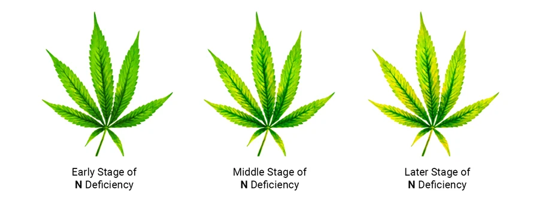
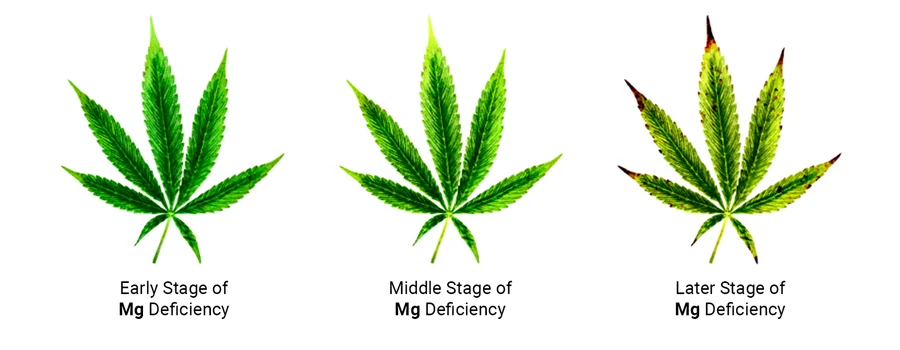
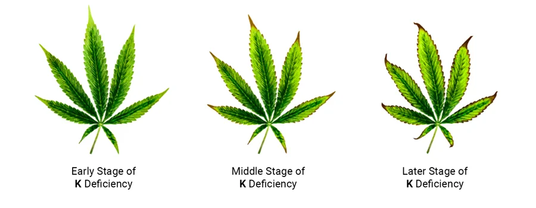
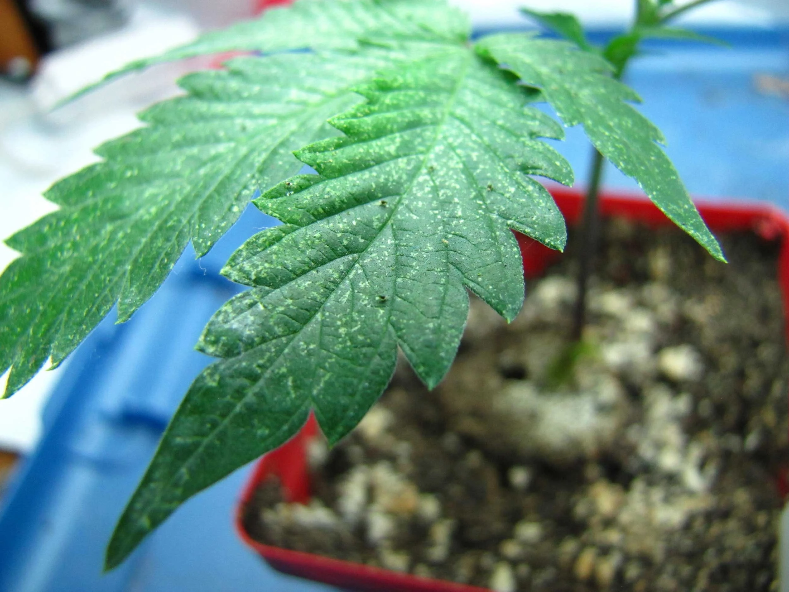
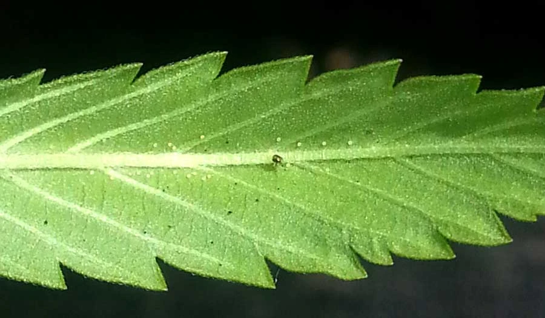
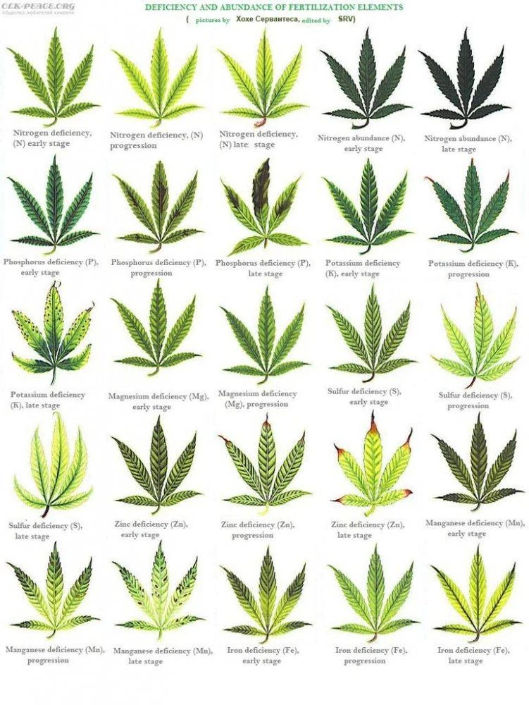

# Carenze e problemi
> Riconoscere e gestire i problemi nutritivi

Le foglie sono il **cruscotto** della pianta. Attenzione però: con una linea
completa di nutrienti (Grow/Micro/Bloom) una "carenza" quasi mai è una vera
mancanza di quell'elemento.

> Regola d'oro: davanti a una carenza, prima **pH → EC → cambio**, poi
> semmai si aggiunge qualcosa. Nell'ordine, mai al contrario.

## Cosa fare quando ne noti una

Nell'ordine, **prima** di aggiungere qualsiasi cosa:

- **Misura pH ed EC.** 8 volte su 10 è il **pH fuori fascia** (blocco) o la
  soluzione **vecchia/scarica**, non un elemento che manca.
- **Sistema il pH** (5,5–6,2) e aspetta qualche giorno: spesso rientra da sola.
- **EC bassa** → aumenta la dose; **acqua vecchia** → cambio.
- **N / P / K**: li regoli con Grow / Micro / Bloom.
- **Magnesio e Calcio**: gli unici che con acqua 50/50 possono davvero mancare —
  se persistono a pH/EC corretti, si aggiunge **Cal-Mag** (o sale di Epsom per il
  solo magnesio). È l'unico integratore che vale la pena tenere.
- Gli altri (ferro, zinco, manganese, boro…): li fornisce il **Micro**; una loro
  carenza è quasi sempre **blocco da pH** → stessa mossa.

## Dove guardare

- Elementi **mobili** (azoto, fosforo, potassio, magnesio): la pianta li sposta
  verso l'alto, quindi i sintomi partono dalle foglie **basse/vecchie**.
- Elementi **immobili** (calcio, ferro, zolfo): sintomi sulle foglie
  **alte/nuove**.

## Le tre più comuni

**Azoto (N)** — ingiallimento **uniforme** che parte dalle foglie basse; in
fioritura un po' è fisiologico.

**Magnesio (Mg)** — giallo tra le nervature (che restano verdi) e verso i bordi,
poi macchie color ruggine e punte bruciate; sulle foglie vecchie.

**Potassio (K)** — punte e bordi che ingialliscono e poi bruciano (marroni),
sulle foglie vecchie.

## Eccessi e parassiti

- Punte bruciate e "artigliate" verso il basso = troppa EC (nutrient burn):
  diluire.
- Ragnetto rosso (puntinatura fine + ragnatele sotto le foglie), afidi, oidio
  (patina bianca polverosa): intervenire presto e isolare. In fioritura evitare
  trattamenti aggressivi sulle cime.

## Annex — tabella di riferimento (approfondimento)

Un quadro visivo di molte carenze ed eccessi (azoto, fosforo, potassio,
magnesio, zolfo, zinco, manganese, ferro) ai vari stadi. È solo per
riconoscere: con la linea Grow/Micro/Bloom, su gran parte di questi non c'è un
intervento specifico — vale sempre prima **pH → EC → cambio** (vedi "Cosa fare"
in alto).

