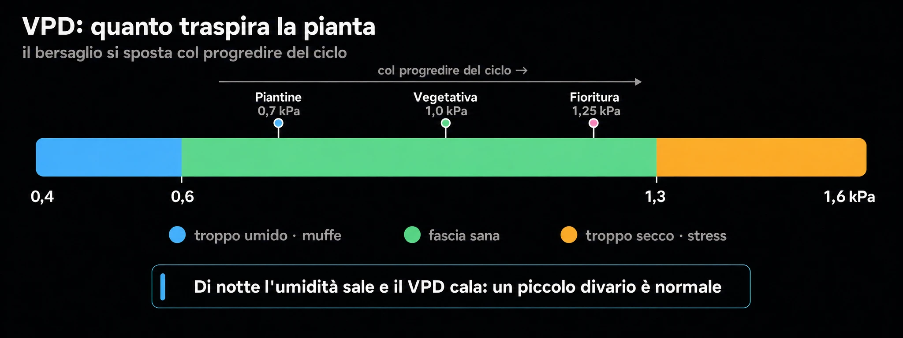

# Clima e VPD
> Temperatura, umidità e come si legano

Temperatura e umidità non vanno guardate da sole ma insieme: il **VPD** (deficit
di pressione di vapore) misura quanto la pianta "traspira". Il pannello colora
già i valori sulle soglie della fase; questa guida spiega come leggerli.

> Lo stesso valore di umidità può andare bene o male a seconda della
> temperatura: è il **VPD** a mettere insieme le due cose.

## L'idea di base

- VPD **basso** (aria umida): la pianta traspira poco e assorbe poco, con
  rischio di muffe.
- VPD **alto** (aria secca o calda): traspira troppo, si stressa e chiude gli
  stomi.
- Si punta a stare nella fascia giusta della fase, spostandosi verso valori un
  po' più alti col progredire del ciclo.

## Orientamenti per fase

- **Piantine / vegetativa iniziale** — umidità più alta, VPD basso (radici
  piccole, traspirano poco).
- **Vegetativa piena** — via di mezzo.
- **Fioritura** — aria più secca, VPD più alto; l'umidità bassa protegge le cime
  dalle muffe.

## Giorno e notte

- Di notte la temperatura scende: l'umidità sale e il VPD cala. Un piccolo
  divario giorno/notte è normale; gli sbalzi forti no.

## Come intervenire

- Troppo umido: più ricambio d'aria o deumidifica, meno foglie stagnanti.
- Troppo secco: umidificare o abbassare un po' la temperatura.
