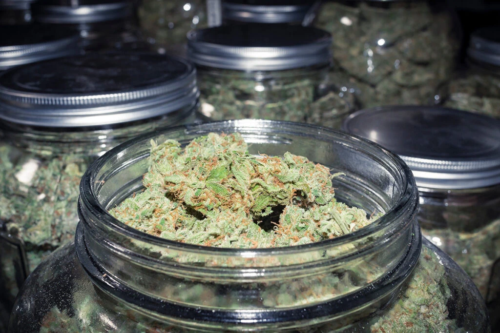
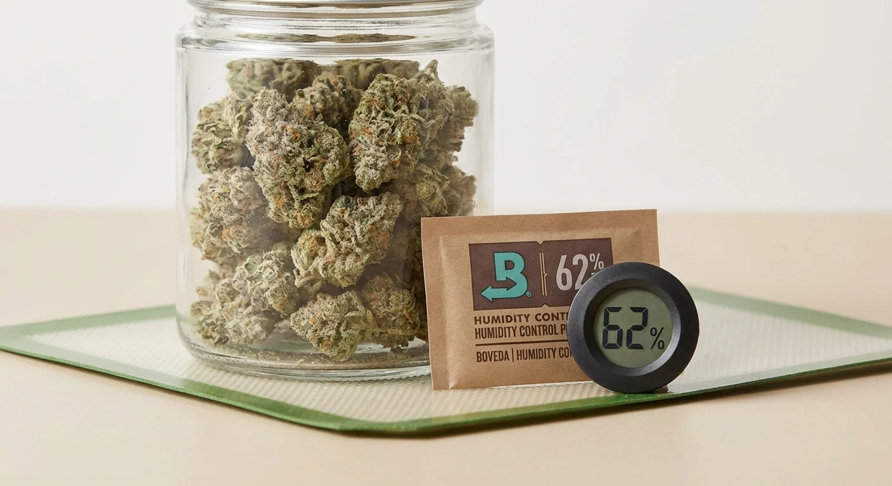

# La concia (curing)
> Il passo che fa la differenza di qualità

La concia è la maturazione in barattolo dopo l'essiccazione. È ciò che trasforma
cime "solo secche" in prodotto rifinito: aroma pieno, fumata morbida, effetto
più pulito. Saltarla significa perdere gran parte del lavoro fatto.

## Come si parte

- Quando l'essiccazione è al punto giusto (test dello stelo), invasare le cime
  in barattoli di vetro a chiusura ermetica.
- Riempire circa **3/4**, senza schiacciare. Chiudere.

## L'umidità giusta

- Target interno ~**58-62% UR**. Un piccolo igrometro nel barattolo (o una
  bustina tampone al 62%) toglie ogni dubbio.
- Sopra ~65%: rischio muffa, aprire più spesso. Sotto ~55%: troppo secca, si può
  reidratare con una bustina tampone.

## Il burping (far respirare)

- **Prima settimana**: aprire i barattoli 1-2 volte al giorno per qualche
  minuto, per scambiare aria e far uscire umidità e ammoniaca.
- Odore di ammoniaca o fieno all'apertura = ancora umida o troppo piena:
  arieggiare di più.
- **Settimane successive**: diradare a una volta ogni pochi giorni.

## Durata

- Minimo utile ~**2 settimane**; buona 3-4 settimane; ottima 1-2 mesi.

> Qui la **pazienza** paga più di qualsiasi nutriente: è il passo che separa
> cime "solo secche" da un prodotto rifinito.
