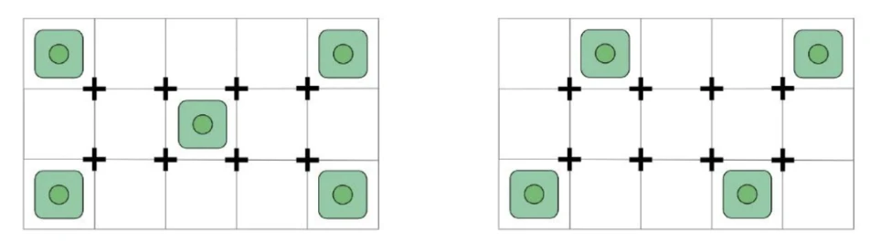

# Disposizione dei panetti
> Come sistemare le piante nella griglia il primo giorno

Il primo giorno i panetti (con i semi germinati o le piantine) vanno messi nelle
celle della griglia della serra. Come si distribuiscono decide quanto sarà
uniforme la chioma: piante troppo vicine si fanno ombra e competono.

## Quante piante e dove

La griglia ha più celle, ma **non vanno riempite tutte**: meglio poche piante
ben distanziate.

> Più piante non vuol dire più raccolto: **distanziarle** dà chioma uniforme,
> meno ombra e meno muffe.

- **5 piante** — una a ogni angolo più una al centro (schema a "5" del dado):
  massima densità utile.
- **4 piante** — una a ogni angolo: più spazio e aria per ciascuna.

## Come sistemarli

- Un panetto per cella, con la piantina centrata.
- Radichetta rivolta verso il basso (vedi la guida *Germinazione*).
- Lasciare vuote le celle tra una pianta e l'altra: servono per far crescere e
  distendere i rami più avanti.

## Perché distanziarle

- Luce e aria arrivano a tutte le piante, non solo a quelle esterne.
- Meno umidità stagnante tra le chiome, quindi meno rischio di muffe.
- Più spazio per lo SCROG e la distensione dei rami in seguito.
