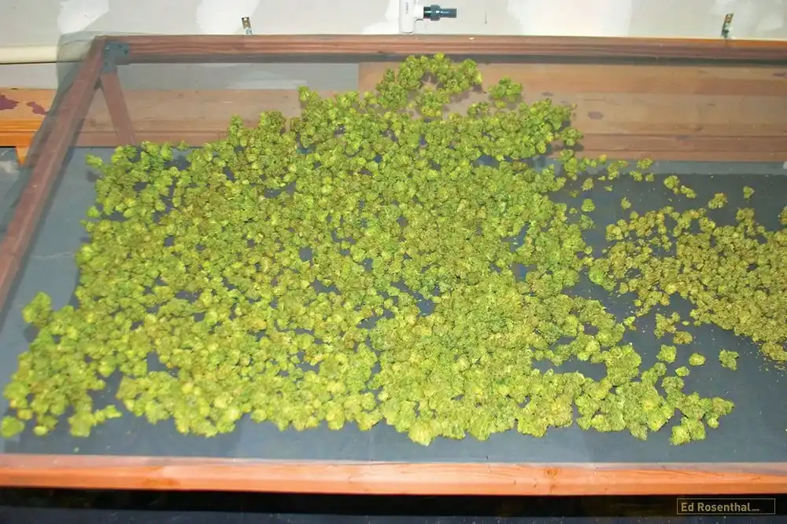
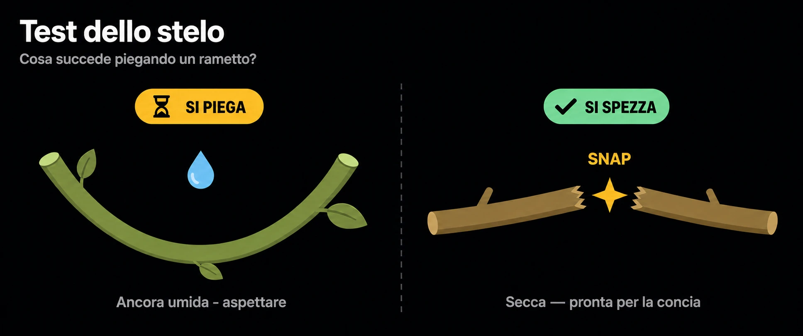
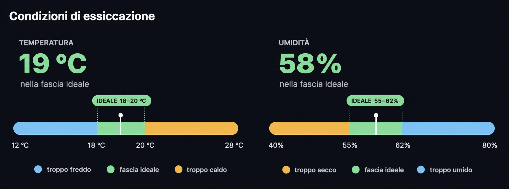

# Essiccazione
> Asciugare lentamente e capire quando è pronta

L'essiccazione è la fase più delicata dopo il taglio: fatta male rovina un
raccolto buono. L'obiettivo è togliere l'acqua **lentamente** (di norma 7-14
giorni), in un ambiente controllato e al buio, per preservare aromi ed evitare
muffe.

> È la lentezza a fare la qualità: un'asciugatura veloce lascia sapore di
> "verde/fieno" che la concia poi non recupera.

## Condizioni ideali

- Temperatura ~**18-20 °C** (il caldo fa evaporare i terpeni).
- Umidità relativa ~**55-62%**.
- **Buio** totale (la luce degrada il THC).
- Aria in leggero movimento, **mai** diretta sulle cime.

## Appese o su rete

- Rami interi appesi: asciugatura più lenta e uniforme (in genere preferibile).
- Cime staccate su rete: più veloce, utile in spazi piccoli o con umidità alta.

## Quando è pronta: il test dello stelo

- Piegare un rametto: se si spezza di netto con uno "snap", è pronta.
- Se si piega senza rompersi, dentro è ancora umida: aspettare.
- Le cime devono risultare asciutte fuori ma non friabili: un filo di morbido
  all'interno va bene, lo rifinisce la concia.

## Rischi

- Troppo veloce (caldo/secco): sa di "verde/fieno" e raspa in gola.
- Troppo lento o umido: rischio muffa — controllare ogni giorno.
