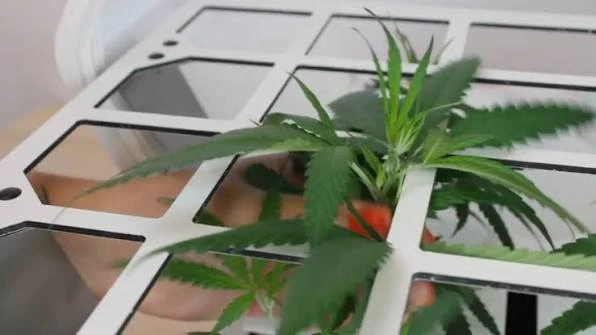
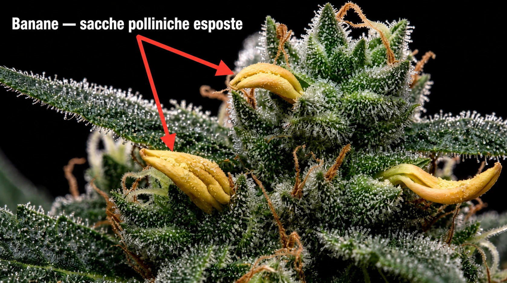

# Fioritura: stretch e sostegno
> Gestire le prime settimane e sostenere le cime

L'inizio della fioritura è dominato dallo **stretch** (allungamento). Poche mosse
fatte bene ora — sfoltire e sostenere — migliorano resa e salute fino al
raccolto.

## Lo stretch

- Nelle prime **2-3 settimane** dopo il flip la pianta si allunga molto e
  spuntano i primi pistilli.
- Poi rallenta e concentra l'energia sulle **cime**.
- Assecondarlo: una rete o dei tutori tengono i rami distesi e alla stessa
  altezza.

## Sfoltire (defogliazione)

- Togliere con misura le foglie a ventaglio che ombreggiano i siti di fiore.
- Obiettivo: **luce e aria alle cime**, meno umidità stagnante.

> Meglio **poco e in due volte** che una potatura drastica in un colpo solo: la
> defogliazione è uno stress, non una pulizia.

## Sostegno

- Le cime diventano pesanti: **rete a maglie** o legature evitano che i rami si
  pieghino o si spezzino.

## Controllo ermafroditismo

- Lo **stress** (sbalzi di luce, buio interrotto, calore) può far comparire
  sacche polliniche — le cosiddette "banane" — tra i fiori.
- Controllare soprattutto dopo uno stress: se presenti, **rimuoverle subito**; se
  sono molte, il rischio è l'impollinazione (semi nelle cime).
