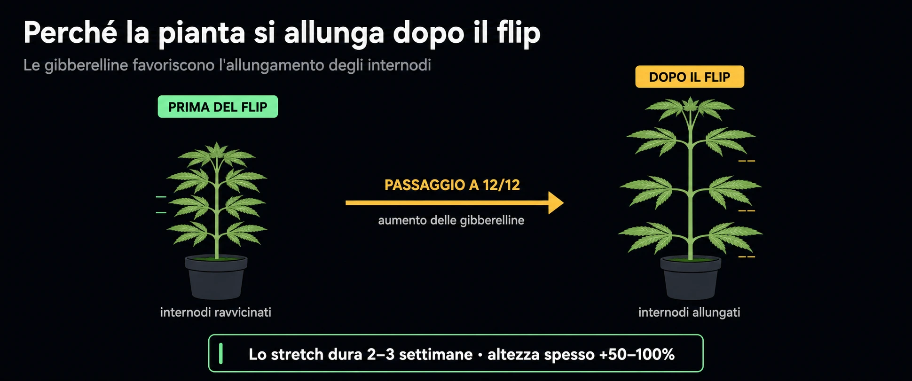
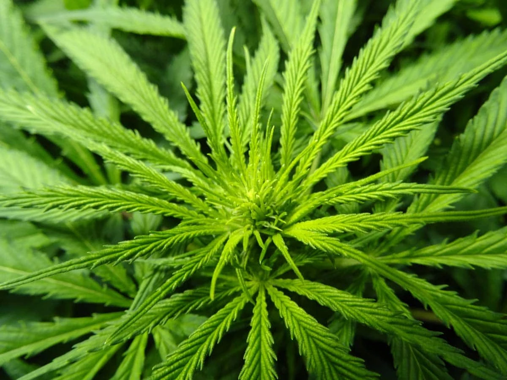
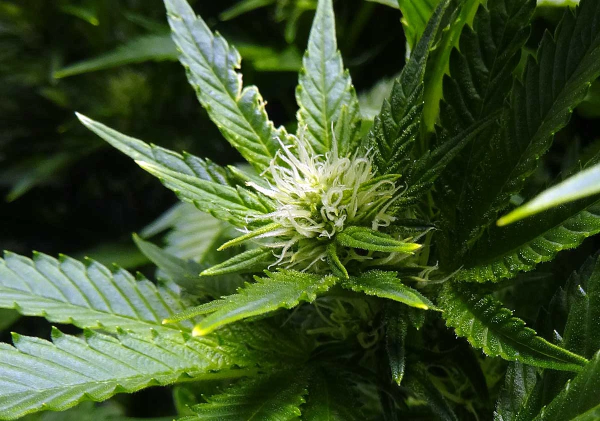

# Quando passare a fioritura
> Il "flip" a 12/12 nelle fotoperiodiche

> [!nota]
> **⚠️ Guida solo per colture fotoperiodiche.** Nelle **autofiorenti** non serve:
> passano a fioritura da sole, in automatico, senza flip — quindi si può ignorare.

Le fotoperiodiche restano in vegetativa finché la luce resta lunga (≥18 ore) e
passano a fiore quando il buio sale a 12 ore. Il **flip** è la decisione di
portare il fotoperiodo a 12/12: da lì parte la corsa alla fioritura. Le
autofiorenti non hanno flip — passano da sole, a prescindere dalla luce.

## Il fattore chiave: lo stretch

Dopo il flip la pianta **raddoppia** di altezza (a volte di più) nelle prime
2-3 settimane.

> Il flip si decide sullo **spazio**, non sull'età: conta l'altezza finale
> prevista, non i giorni.

- Regola pratica: flippare quando la pianta è a circa **metà** dell'altezza
  finale desiderata, tenendo conto della distanza dalla luce.

## Segnali che è pronta

- Struttura robusta e chioma piena, internodi corti (non "filata").
- Almeno 4-5 nodi ben sviluppati.
- Se si vuole allenarla (topping/LST), farlo **prima** del flip e lasciarle
  circa una settimana per riprendersi.

## Cosa succede dopo

- 1ª-3ª settimana: allungamento e primi pistilli.
- Poi la pianta smette di crescere in altezza e ingrossa le cime.
- I nutrienti passano gradualmente alla formula da fioritura (meno azoto).

## Da valutare prima

- Spazio verticale disponibile (altezza serra, distanza luce).
- Salute: non flippare una pianta stressata o carente — lo stress nella
  transizione aumenta il rischio di ermafroditismo.
