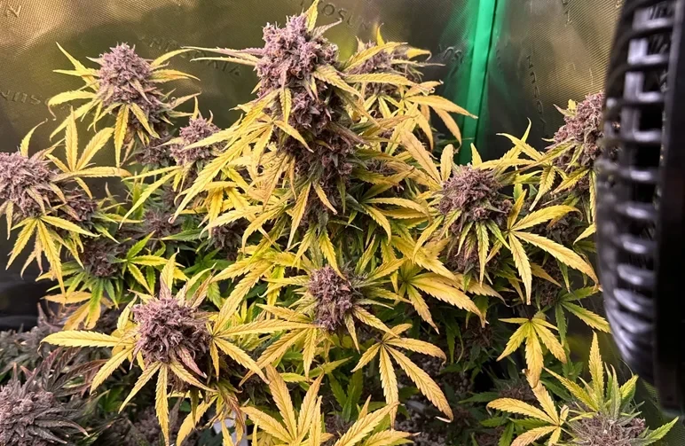

# Il flush finale
> Solo acqua, prima del raccolto

Il flush è il periodo finale in cui si dà **solo acqua** (in idroponica, acqua
con il pH corretto ma senza nutrienti) per far consumare alla pianta le riserve
accumulate. Obiettivo: cime più pulite al gusto e cenere più chiara. In idro
serve poco, perché non c'è substrato che trattiene i sali.

## Quando iniziarlo

- Si parte dalla stima del raccolto: a decidere sono i **tricomi** (vedi la
  guida *Quando raccogliere*).
- Indicativamente **3-7 giorni** prima del taglio in idroponica (meno che in
  terra).
- Segnale di conferma: le foglie a ventaglio iniziano a sfumare e ingiallire —
  la pianta sta riciclando l'azoto dalle riserve.

## Come si fa in idroponica

- Svuotare la vasca e riempirla con sola acqua (50/50 come sempre), pH corretto,
  **nessun nutriente**.
- Se l'EC risale sensibilmente (la pianta rilascia sali), cambiare di nuovo
  l'acqua.
- Resto invariato: luci, clima, ricircoli.

## Come capire che è a posto

- L'ingiallimento progressivo in questa fase è **normale e voluto**.

> La decisione del taglio resta dei **tricomi**: il flush *accompagna* il
> raccolto, non lo anticipa.

## Nota

In idroponica il flush è meno critico che in terra. Meglio pochi giorni fatti
bene che un flush lungo su una pianta non ancora matura.
