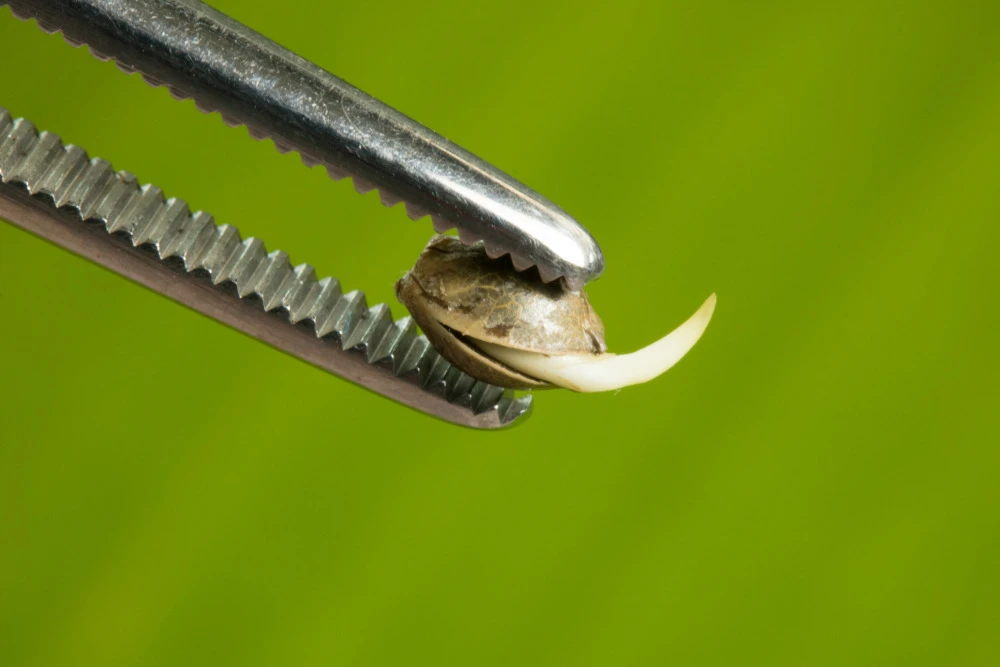
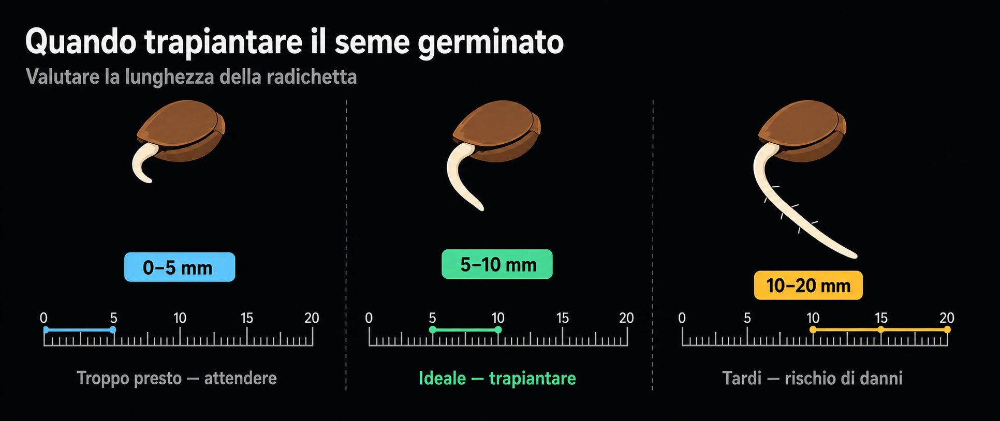
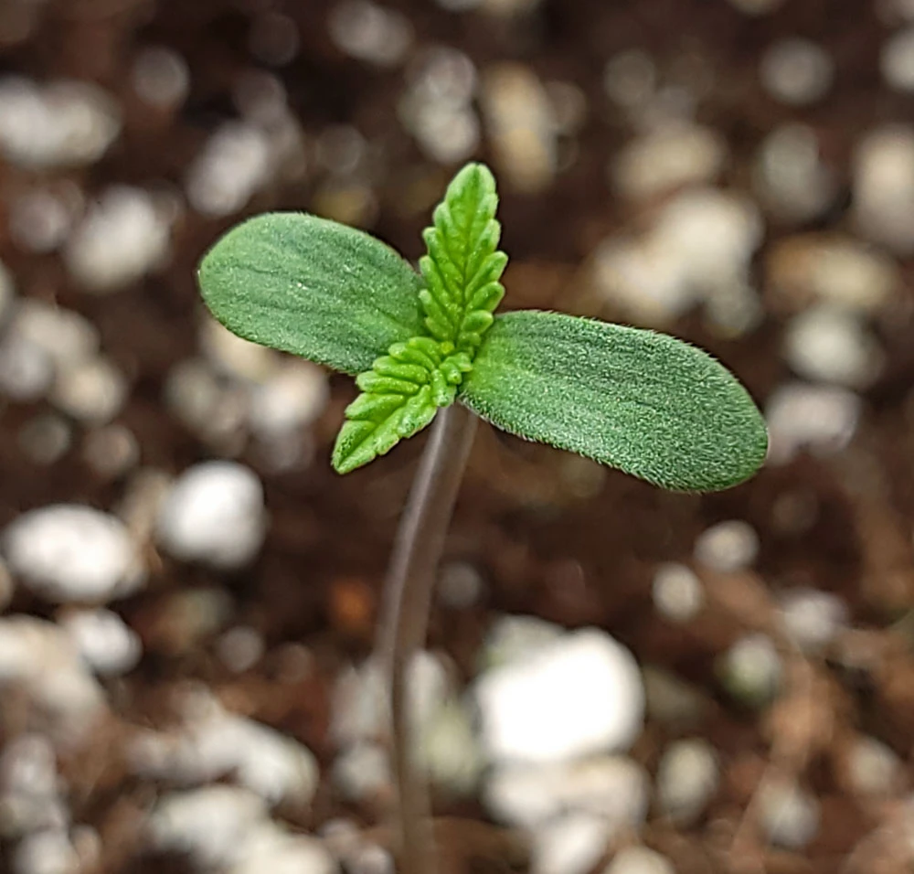

# Germinazione e trapianto
> Dal seme alla piantina

La germinazione è il primo passo e uno dei più delicati: la piantina ha poche
riserve e radici fragili. Servono **umidità, tepore e delicatezza**.

> Maneggiare il seme il meno possibile e **non toccare mai la radichetta**: è la
> parte più fragile.

## Far germinare

- **Metodi comuni:** tra tovaglioli umidi, in cubo di lana di roccia o jiffy, o
  direttamente nel supporto finale.
- Ambiente **~22-26 °C**, umido e al buio finché non spunta la radichetta.

**Quando interrarlo:** appena la radichetta è spuntata bene, indicativamente sui
**5–10 mm** (più corta = ancora presto; oltre ~2 cm si rischia di danneggiarla).
Interrare con la **radichetta rivolta verso il basso**.

## La piantina

- Spuntano prima i due **cotiledoni** (foglie tonde "di riserva"), poi la prima
  coppia di **foglie vere** seghettate.
- Luce dolce e non troppo vicina; **umidità alta** (cupola) nei primi giorni.

## Quando trapiantare in idroponica

- Quando la radichetta è ben sviluppata e la piantina ha la **prima o la seconda
  coppia di foglie vere**.
- Trasferire con delicatezza nel net-pot, con le radici rivolte verso
  l'acqua/nebulizzazione.
- **EC molto bassa** all'inizio: le piantine si bruciano facilmente.

## Attenzione

- Troppa acqua diretta e poca ossigenazione = **marciume**. Troppo caldo o
  secco = la piantina si **accartoccia**.
