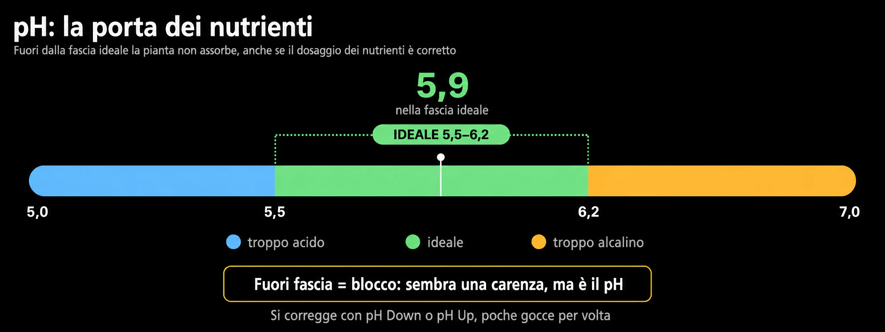

# pH ed EC
> Le due misure che contano ogni giorno

In idroponica quasi tutti i problemi nutrizionali passano da pH ed EC. Sono due
penne economiche e cinque minuti di lettura: vale sempre la pena.

## Il pH — la porta dei nutrienti

- Target in idroponica: ~**5,5-6,2**.
- Fuori range la pianta non **assorbe** certi elementi anche se presenti: si
  vedono carenze pur avendo dosato tutto (*lockout*).

> Prima di aggiungere qualcosa contro una "carenza", controllare il pH: quasi
> sempre è **lockout**, non un elemento che manca.
- Si corregge con pH Down (acido) o pH Up, poche gocce per volta, rimescolando e
  rimisurando.

## L'EC — quanto è "carica" la soluzione

- L'EC misura la concentrazione totale di sali disciolti.
- A grandi linee sale con la fase: bassa per piantine, media in vegetativa,
  piena in fioritura, quasi nulla nel flush.
- EC che **sale** nel tempo = la pianta beve più acqua che sali (soluzione
  troppo carica): diluire.
- EC che **scende** = sta consumando i nutrienti: si avvicina il cambio.

## L'ordine giusto

- Prima si porta l'EC al valore voluto (nutrienti), **poi** si aggiusta il pH:
  aggiungere nutrienti sposta sempre il pH.

## Manutenzione degli strumenti

- Calibrare le penne ogni tanto con le soluzioni tampone e tenerle pulite. Una
  **penna scalibrata mente con sicurezza**.
