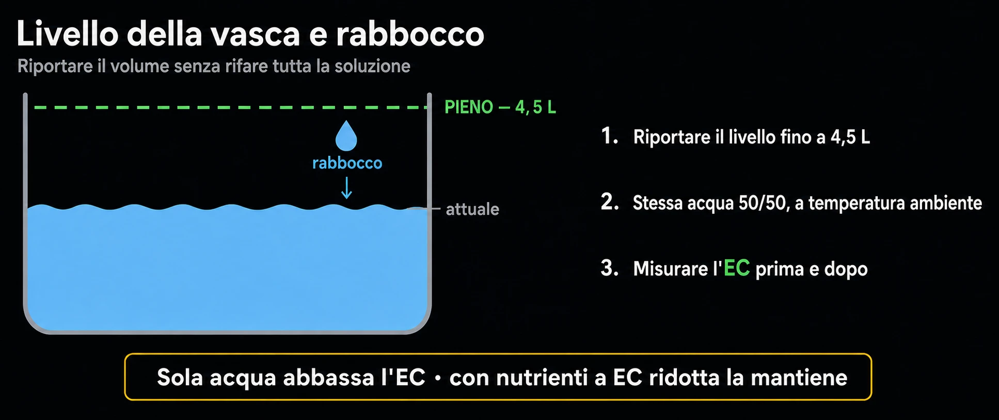

# Rabbocchi
> Ripristinare il livello tra un cambio e l'altro

Tra un cambio completo e l'altro il livello della vasca scende: la pianta beve e
un po' d'acqua evapora. Il rabbocco ripristina il volume senza rifare tutta la
soluzione.

## Acqua o acqua + nutrienti?

- La pianta consuma acqua e sali a ritmi diversi: spesso beve più acqua che
  nutrienti.
- Rabbocco di **sola acqua**: abbassa l'EC (diluisce). Utile se l'EC era salita.
- Rabbocco con **nutrienti a EC ridotta**: mantiene la concentrazione se l'EC
  stava scendendo.

> La bussola è sempre l'**EC**: misurare prima e dopo il rabbocco, e decidere di
> conseguenza.

## Come fare

- Usare la stessa acqua di base (50/50), a temperatura ambiente.
- Aggiungere poco per volta e ricontrollare pH ed EC dopo il rabbocco.

## Quando conviene invece il cambio completo

- Se l'acqua è vecchia, torbida o con segni di melma, non rabboccare: cambiare
  tutto (vedi la guida *Cambio acqua e nutrienti*).
