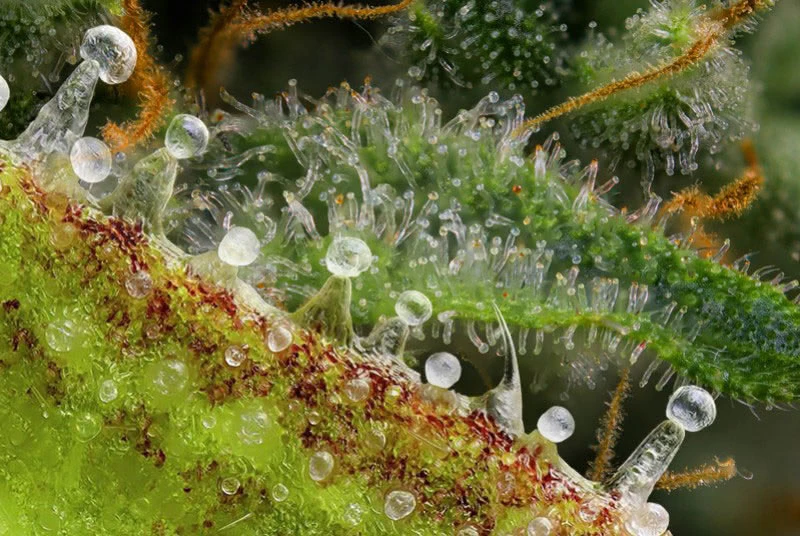
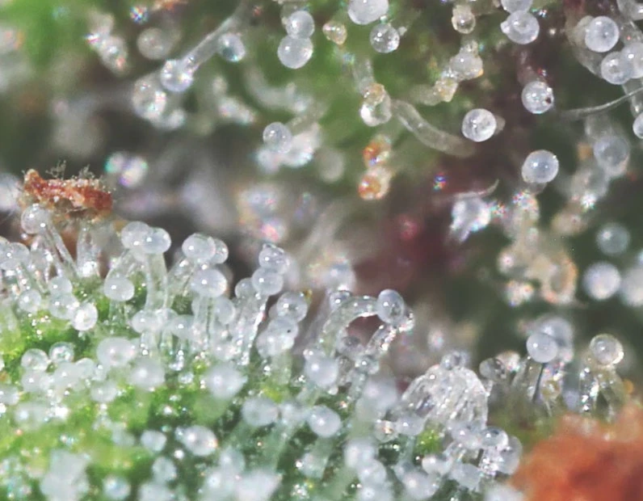
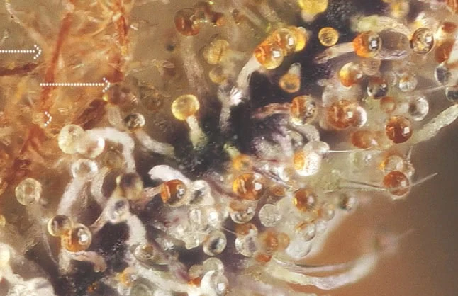
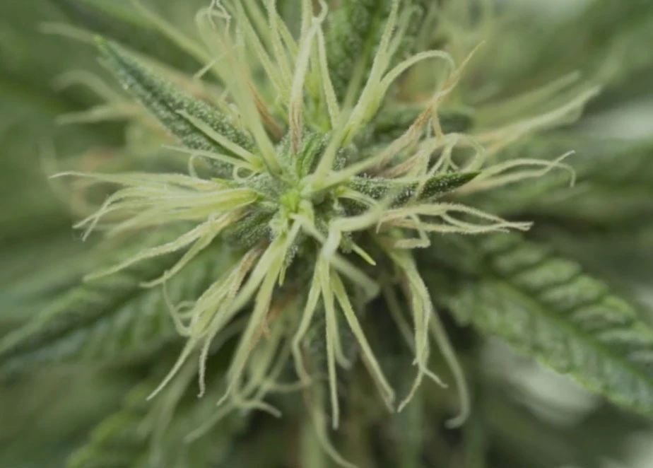
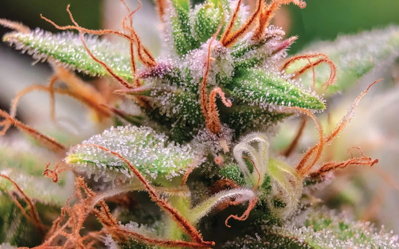
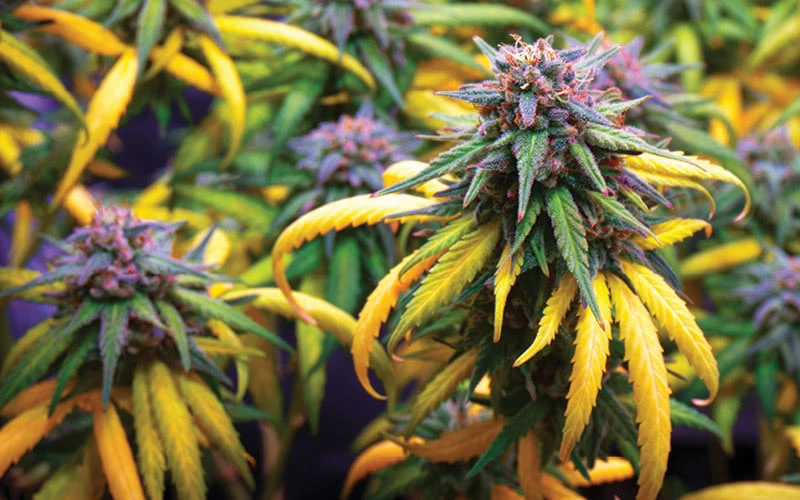
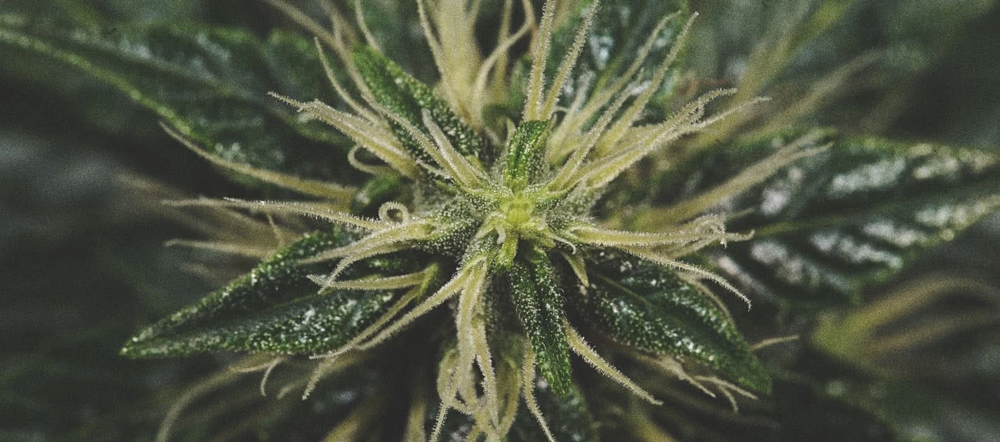

# Quando raccogliere
> Capire che le cime sono al punto giusto

Il momento del taglio decide qualità e potenza. **Troppo presto:** pochi
cannabinoidi, meno THC. **Troppo tardi:** il THC degrada in CBN, con un effetto
più letargico. Il segnale più affidabile sono i **tricomi**; pistilli, foglie e
calici servono a confermare.

> Il calendario è solo un'indicazione: a decidere il taglio sono i **tricomi**,
> non i giorni.

## Tricomi — il segnale più affidabile

I tricomi sono le ghiandole di resina sulle cime — piccoli "funghetti" con una
pallina in punta. Per vederli bene serve un **microscopio tascabile** o una buona
lente.

Regola pratica: tagliare quando la maggior parte è **lattiginosa**, con qualche
ambrato a seconda dell'effetto desiderato.

- **Trasparenti** — ancora presto: ghiandole giovani, pochi cannabinoidi
- **Lattiginosi / opachi (oltre ~70%)** — THC al massimo: effetto cerebrale, euforico ed energico
- **Ambrati** — il THC degrada in CBN: effetto più sedativo e rilassante

## Pistilli

I pistilli sono i filamenti: prima bianchi, poi virano ad
arancione/rosso/marrone. Con il **60-70% rosso/marrone** il raccolto è vicino;
nel 70-90% l'effetto è più potente.

Da soli non bastano: durante il flush possono virare anche se i fiori non sono
maturi. Vanno **sempre confrontati con i tricomi**.

## Foglie a ventaglio ingiallite

A fine fioritura molte foglie a ventaglio (le grandi) ingialliscono e cadono: è
**normale** — la pianta sposta le energie sui fiori.

Va comunque escluso che sia una **carenza nutritiva** o un **attacco di
parassiti**.

## Calici che si ingrossano

I calici (la base del fiore, la parte più resinosa) si ingrossano avvicinandosi alla maturità: si preparano a ospitare i semi. Un ingrossamento evidente è un altro segnale di maturità.

## Stima dalla varietà

Come riferimento incrociato si può considerare il tempo di fioritura dichiarato della varietà — ma la decisione la danno i tricomi, non il calendario.
