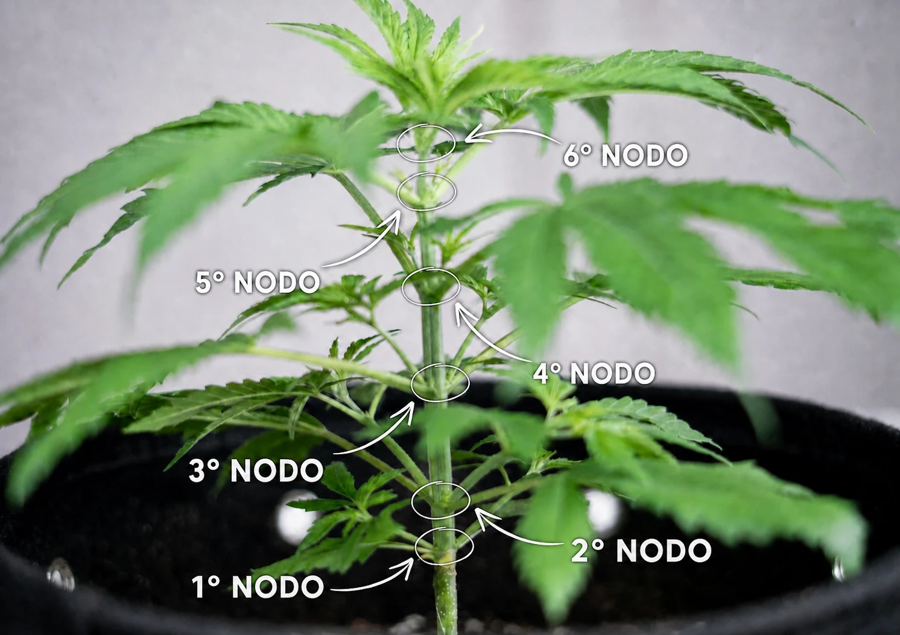
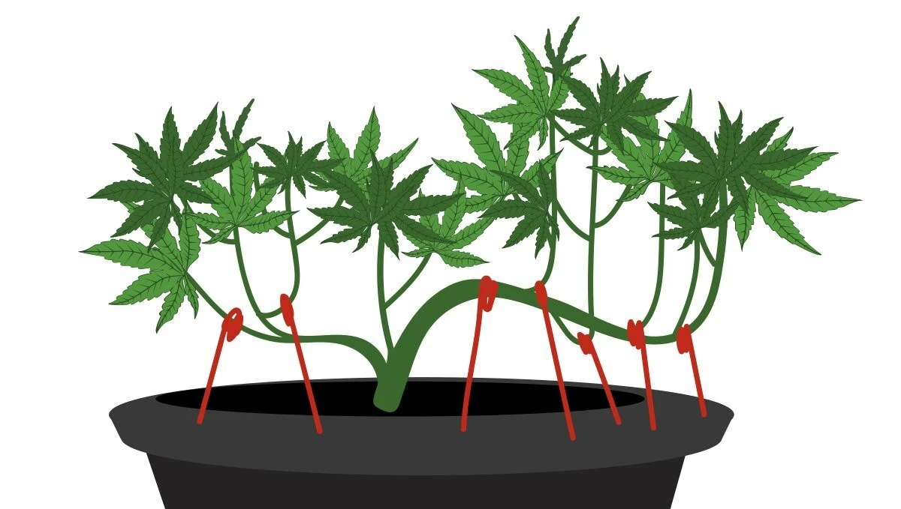

# Topping e LST
> Dare forma alla pianta in vegetativa

Il training serve a ottenere una chioma larga e uniforme invece di una sola cima
dominante: più siti di fioritura alla stessa altezza e luce distribuita meglio.
Due tecniche di base: **topping** (taglio) e **LST** (piegatura).

> L'obiettivo non è "potare" ma **ridistribuire**: più cime alla stessa altezza
> ricevono la stessa luce e maturano insieme.

## Topping

- Consiste nel togliere l'apice sopra un nodo: si rompe la **dominanza apicale**
  e la pianta sviluppa due (o più) cime al posto di una.
- Quando: con almeno **5-6 nodi**, pianta sana e in crescita attiva.
- Come: taglio netto e pulito sopra il nodo scelto, con attrezzo disinfettato.
- Lasciare circa una settimana di ripresa prima di altri stress (o del flip).

**Contare i nodi:** un nodo è il punto del fusto da cui partono foglie o rami;
si contano dal basso verso l'alto.

**Dove tagliare:** si toglie l'apice — il ciuffetto in cima — con un taglio netto
**appena sopra un nodo**. Il riferimento pratico è **sopra il 5° nodo**: quanti
nodi restano sotto è un compromesso — più nodi = più cime ma pianta più alta,
meno nodi = struttura più compatta.

## LST (Low Stress Training)

- Piegare delicatamente i rami verso l'esterno e fissarli con legacci **morbidi**
  o filo rivestito, senza spezzarli.
- Apre il centro della pianta alla luce e pareggia le cime.
- A **basso stress**: si può fare in modo continuativo durante la vegetativa.

## Regole

- Allenare in vegetativa, non in piena fioritura.
- Sulle fotoperiodiche: completare il grosso del training **prima** del flip.
- Sulle autofiorenti: preferire l'LST (poco stress); il topping va fatto molto
  presto o evitato, perché il ciclo è fisso e non aspetta la ripresa.
