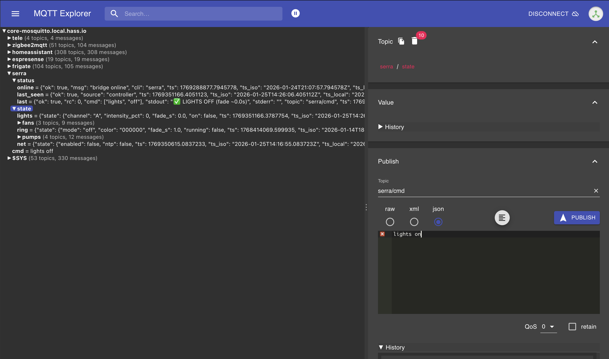

# Riferimento comandi

**Percorso guidato:** [Indice dei capitoli](index.md) · [Installazione controller](setup/06-controller-cli.md) · [Collegamento Home Assistant](setup/09-home-assistant.md)

Questa pagina raccoglie i comandi **per completezza della documentazione** e per chi vuole fare prove manuali. Riordina l'[help della CLI](https://github.com/Interstellar0verdrive/Linfa-local-control/blob/main/bridge/serra_help.txt) e mostra, per ogni azione, il payload MQTT equivalente. **Per usare normalmente la serra da Home Assistant non sarà necessario imparare questi comandi:** l'app dedicata, pronta e in fase di test, li invierà e gestirà dall'interfaccia. L'app non è ancora inclusa nella repository; i comandi manuali funzionano dopo aver completato il percorso guidato.

Sul Raspberry, dopo aver installato il controller, puoi leggere l'help completo con:

```bash {.terminal-raspberry}
serra --help
```

Per i comandi manuali via SSH, `serra auth save` chiede una volta la password della console della serra e la conserva in un file privato dell'utente sul Raspberry. È un comando **solo locale**: non si invia via MQTT e non modifica la serra. Anche i servizi automatici eseguiti come utente `pi` leggono la password da quel file, senza duplicarla nella configurazione MQTT; vedi il [passo 06](setup/06-controller-cli.md).

## Dove fare le prove MQTT

Puoi pubblicare i comandi dall'[integrazione MQTT di Home Assistant](setup/09-home-assistant.md#alternativa-usare-gli-strumenti-mqtt-integrati), ma per esplorare i topic e osservare le risposte **MQTT Explorer** è più comodo:

- **Dentro Home Assistant OS:** installa l'app comunitaria MQTT Explorer dal [repository di GollumDom](https://github.com/GollumDom/addon-repository), poi collegala al broker usato dal Raspberry. È uno strumento facoltativo e indipendente da questo progetto.
- **Da Windows, macOS o Linux:** usa [MQTT Explorer per desktop](https://mqtt-explorer.com/). Il computer deve raggiungere il broker sulla rete e autenticarsi con credenziali MQTT valide; non deve aprire Home Assistant. Se il broker è l'app Mosquitto di Home Assistant, dal computer usa l'indirizzo di rete di Home Assistant, non il nome interno `core-mosquitto.local.hass.io` visibile nello screenshot.

In MQTT Explorer seleziona **raw** per un payload testuale come `lights on`, pubblica su `serra/cmd` con **retain disattivato** e osserva `serra/status/last` e `serra/state/*`. L'immagine mostra una sessione reale: nel pannello di pubblicazione è rimasta selezionata la modalità **JSON**, che va cambiata in **raw** prima di inviare i comandi testuali di questa pagina.

<figure class="ha-preview" markdown="1">
  [](assets/mqtt-explorer.png)
  <figcaption>MQTT Explorer: topic di stato a sinistra e pubblicazione su <code>serra/cmd</code> a destra. Per <code>lights on</code> seleziona <strong>raw</strong>, non JSON; lascia <strong>retain</strong> disattivato. Apri l'immagine per ingrandirla.</figcaption>
</figure>

## Come leggere le tabelle

Sul Raspberry esegui l'intera riga che inizia con `serra`. Da Home Assistant o MQTT Explorer pubblica **solo il payload**, senza il prefisso `serra`, sul topic `serra/cmd`. Se hai modificato `SERRA_MQTT_TOPIC`, sostituisci `serra` con il tuo topic base. **Retain deve essere disattivato per tutti i comandi**, così un messaggio non viene ripetuto quando il bridge si riconnette.

| Dove | Topic | Testo da inviare |
| --- | --- | --- |
| Raspberry | — | `serra lights on -i 80 -f 15` |
| Client MQTT | `serra/cmd` | `lights on -i 80 -f 15` |

Nelle tabelle, le parti tra `<…>` sono valori da sostituire. Le opzioni tra parentesi quadre sono facoltative. Le opzioni lunghe (`--intensity`) e brevi (`-i`) sono equivalenti.

## Luci

| Azione | Raspberry | Payload MQTT |
| --- | --- | --- |
| Accendere tutti i LED | `serra lights on [-i 0..100] [-f secondi]` | `lights on [-i 0..100] [-f secondi]` |
| Spegnere tutti i LED | `serra lights off [-f secondi]` | `lights off [-f secondi]` |
| Impostare un canale | `serra lights set <A/G/B/R/D> [-i 0..100] [-f secondi]` | `lights set <A/G/B/R/D> [-i 0..100] [-f secondi]` |
| Applicare una ricetta | `serra lights preset <viola/verde/bianco> [-i 0..100] [-f secondi]` | `lights preset <viola/verde/bianco> [-i 0..100] [-f secondi]` |
| Impostare i cinque canali insieme | `serra lights mix [-a %] [-g %] [-b %] [-r %] [-d %] [-f secondi]` | `lights mix [-a %] [-g %] [-b %] [-r %] [-d %] [-f secondi]` |

`-i, --intensity` imposta l'intensità percentuale, da `0` a `100` (predefinito `100`). `-f, --fade` indica la durata **approssimata** della dissolvenza in secondi (predefinito `0`). `lights off` non accetta `-i`.

`preset` e `mix` impostano **tutti e cinque i canali**: quelli non previsti dalla ricetta o omessi nel mix vengono spenti. La ricetta `viola` usa `R=100`, `D=100`, `B=40`; `verde` usa solo `G=100`; `bianco` usa solo `A=100`. Con `preset -i`, il valore scala l'intera ricetta. Nel mix, `-a/-g/-b/-r/-d` indicano le percentuali dei singoli canali e valgono `0` se omessi.

| Canale | LED controllati |
| --- | --- |
| `A` | Tutti, spettro completo |
| `G` | Verdi |
| `B` | Blu e bianchi |
| `R` | Prima metà dei rossi |
| `D` | Seconda metà dei rossi |

Esempi (ogni payload va pubblicato su `serra/cmd`, con **raw** e senza retain):

| Risultato | Sul Raspberry | Payload MQTT |
| --- | --- | --- |
| Accendi tutto all’80% con dissolvenza di circa 15 secondi | `serra lights on --intensity 80 --fade 15` | `lights on --intensity 80 --fade 15` |
| Porta i soli LED verdi al 40% in circa 5 secondi | `serra lights set G -i 40 -f 5` | `lights set G -i 40 -f 5` |
| Spegni il solo canale verde | `serra lights set G -i 0` | `lights set G -i 0` |
| Spegni tutti i LED con dissolvenza | `serra lights off -f 10` | `lights off -f 10` |
| Applica la ricetta viola al 60% | `serra lights preset viola -i 60` | `lights preset viola -i 60` |
| Usa solo verde e rossi con una dissolvenza | `serra lights mix -g 30 -r 70 -d 70 -f 2` | `lights mix -g 30 -r 70 -d 70 -f 2` |

## Ventole

| Azione | Raspberry | Payload MQTT |
| --- | --- | --- |
| Accendere tutte | `serra fans on [-i livello]` | `fans on [-i livello]` |
| Spegnere tutte | `serra fans off` | `fans off` |
| Impostarne una o tutte | `serra fans set <1/2/F/all> [-i livello]` | `fans set <1/2/F/all> [-i livello]` |

`1` e `2` identificano le prime due ventole; `F` è quella frontale. I livelli per `-i, --intensity` sono `off` (0%), `low` (circa 50%), `medium` (circa 75%, predefinito) e `high` (100%). Quando chiedi `low` o `medium`, il controller esegue prima un breve avvio al 100%: sotto circa il 40% una ventola ferma potrebbe non partire.

| Risultato | Sul Raspberry | Payload MQTT |
| --- | --- | --- |
| Accendi tutte le ventole al livello predefinito | `serra fans on` | `fans on` |
| Porta la ventola 1 al massimo | `serra fans set 1 -i high` | `fans set 1 -i high` |
| Imposta la ventola frontale su low | `serra fans set F --intensity low` | `fans set F --intensity low` |
| Spegni la sola ventola 2 | `serra fans set 2 -i off` | `fans set 2 -i off` |

## Pompe

| Azione | Raspberry | Payload MQTT |
| --- | --- | --- |
| Avviare la pompa principale | `serra pump main on [-s secondi]` | `pump main on [-s secondi]` |
| Fermare subito la pompa principale | `serra pump main off` | `pump main off` |
| Azionare una pompa nutrienti | `serra pump nutrient <0/1/2> [-s secondi] [-t volte] [-i pausa]` | `pump nutrient <0/1/2> [-s secondi] [-t volte] [-i pausa]` |

Per la pompa principale `-s, --seconds` vale **1 secondo** per impostazione predefinita ed è convertito a un numero intero; il limite tecnico è 300 secondi. Durate di 30 secondi o più sono già elevate: usa tempi brevi durante le prove. `pump main off` invia lo stop immediato.

Per le pompe nutrienti `-s, --seconds` è la durata di una singola erogazione (predefinito `1`, massimo **60 secondi**), `-t, --times` il numero di ripetizioni (predefinito `1`, massimo richiesto `100`) e `-i, --interval` la pausa fra ripetizioni (predefinito `1` secondo, massimo `120`). Il controller può **ridurre il numero di ripetizioni richiesto** per non occupare troppo a lungo la UART; controlla il messaggio stampato e non presumere che `-t 100` esegua 100 impulsi. Il dosaggio reale dipende dalla pompa, dal liquido e dal circuito: calibra con tempi piccoli prima di usarla sulle piante. Non esiste un'azione `pump nutrient off` nella CLI: ogni impulso viene inviato con la durata richiesta.

Per la pompa principale il controller avvia anche un arresto di sicurezza sul Raspberry dopo la scadenza prevista più un margine. **Non usarlo come unica protezione dall'allagamento:** verifica fisicamente i comandi di pompa e usa durate brevi nelle prove.

Il bridge interrompe un comando CLI dopo **120 secondi** per impostazione predefinita (`SERRA_CMD_TIMEOUT`): sequenze di pompe o lampeggi più lunghe vanno evitate via MQTT, oppure richiedono una configurazione consapevole del timeout. Se arriva un timeout, **verifica fisicamente** cosa è già stato eseguito prima di inviare di nuovo il comando: ripeterlo può dosare due volte.

| ID | Gocciolatore nel prototipo |
| --- | --- |
| `0` | Destra, vasetto verde |
| `1` | Centro, vasetto azzurro |
| `2` | Sinistra, vasetto rosso |

Esempi: **verifica prima l’ID della pompa** e comincia con durate brevi, perché questi comandi azionano davvero le pompe.

| Risultato | Sul Raspberry | Payload MQTT |
| --- | --- | --- |
| Aziona la pompa principale per 3 secondi | `serra pump main on -s 3` | `pump main on -s 3` |
| Ferma subito la pompa principale | `serra pump main off` | `pump main off` |
| Aziona una volta la pompa nutrienti 0 per mezzo secondo | `serra pump nutrient 0 -s 0.5` | `pump nutrient 0 -s 0.5` |
| Aziona due volte la pompa nutrienti 1, un secondo per volta, con 3 secondi di pausa | `serra pump nutrient 1 -s 1 -t 2 -i 3` | `pump nutrient 1 -s 1 -t 2 -i 3` |

## LED ring

| Azione | Raspberry | Payload MQTT |
| --- | --- | --- |
| Accendere | `serra ring on [-c colore] [-f secondi]` | `ring on [-c colore] [-f secondi]` |
| Spegnere | `serra ring off [-f secondi]` | `ring off [-f secondi]` |
| Lampeggiare | `serra ring blink [-c colore] [-t volte] [-f secondi] [-d durata] [-i pausa]` | `ring blink [-c colore] [-t volte] [-f secondi] [-d durata] [-i pausa]` |

`-c, --color` accetta `white`, `red`, `green`, `yellow`, `orange`, `blue`, `purple`, `off` oppure un codice esadecimale RGB di sei cifre, per esempio `F90023`. Il predefinito è `white`. `-f, --fade` è la dissolvenza approssimata in secondi (predefinito `0`). Per `blink`, `-t, --times` indica i lampeggi (predefinito `5`, massimo `100`), `-d, --duration` la durata accesa (predefinito `1` secondo, massimo `60`) e `-i, --interval` la pausa spenta (predefinito `1` secondo, massimo `10`). La sequenza `blink` resta in esecuzione fino al termine dei cicli.

Come per le pompe nutrienti, il controller può ridurre i lampeggi richiesti se la sequenza terrebbe occupata la UART troppo a lungo.

| Risultato | Sul Raspberry | Payload MQTT |
| --- | --- | --- |
| Accendi il ring verde con dissolvenza | `serra ring on -c green -f 5` | `ring on -c green -f 5` |
| Lampeggia 3 volte con un colore RGB, 2 secondi acceso e 1 spento | `serra ring blink -c F90023 -t 3 -d 2 -i 1` | `ring blink -c F90023 -t 3 -d 2 -i 1` |
| Spegni il ring in circa 3 secondi | `serra ring off --fade 3` | `ring off --fade 3` |

## Checkup, rete e stato

| Azione | Raspberry | Payload MQTT |
| --- | --- | --- |
| Testare i componenti | `serra checkup [opzioni]` | `checkup [opzioni]` |
| Disattivare la rete della **serra** | `serra net off [-n on/off]` | `net off [-n on/off]` |
| Riattivare la rete della **serra** | `serra net on [-n on/off]` | `net on [-n on/off]` |
| Ricalcolare e ripubblicare gli stati | `serra state sync` | `state sync` |

Il **checkup è intrusivo**: sovrascrive le impostazioni dei gruppi inclusi e tenta di spegnere luci, ventole e ring anche se una prova fallisce. Un comando di spegnimento può comunque fallire: controlla fisicamente la serra al termine o dopo un'interruzione. Puoi escludere gruppi dal test con `-l, --lights`, `-f, --fans`, `-lr, --led-ring`, `-pm, --pump-main` e `-pn, --pump-nutrients`: ogni opzione accetta `on` (predefinito) o `off`. Per esempio, `checkup -pm off -pn off` non prova le pompe.

`net on/off` agisce sul **VoCore della serra**, non sulla rete del Raspberry. `-n, --ntp on/off` permette di forzare NTP; senza opzione, NTP segue l'azione di rete. `net on` non è permanente: un riavvio o la policy automatica possono disattivare di nuovo la rete. Un esito positivo conferma l'esecuzione dei comandi nella shell, **non** la disconnessione radio: verifica separatamente che la serra non sia più raggiungibile.

`state sync` aggiorna i timer e ripubblica su `serra/state/*` gli **stati logici attesi**. Non interroga i sensori della serra per confermare lo stato fisico delle ventole, delle luci o delle pompe.

| Risultato | Sul Raspberry | Payload MQTT |
| --- | --- | --- |
| Prova luci, ventole e ring, escludendo entrambe le famiglie di pompe | `serra checkup -pm off -pn off` | `checkup -pm off -pn off` |
| Disattiva la rete della serra e il suo NTP | `serra net off` | `net off` |
| Riattiva la rete della serra ma lascia NTP disattivato | `serra net on --ntp off` | `net on --ntp off` |
| Ripubblica gli stati logici | `serra state sync` | `state sync` |

Anche il checkup senza pompe cambia temporaneamente luci, ventole e ring e li lascia spenti alla fine: usalo solo quando puoi osservare la serra.

## Livello dell'acqua

Il livello è una **stima** ricavata dal magnetometro e dal galleggiante della serra. Calibra una volta con vasca vuota e piena; fai le letture con pompa ferma e acqua a riposo. Il riferimento `earth` è facoltativo e non entra nel calcolo della percentuale.

| Azione | Raspberry | Payload MQTT |
| --- | --- | --- |
| Leggere i valori grezzi | `serra water read` | `water read` |
| Salvare la vasca vuota | `serra water calibrate empty` | `water calibrate empty` |
| Salvare la vasca piena | `serra water calibrate full` | `water calibrate full` |
| Salvare il riferimento opzionale | `serra water calibrate earth` | `water calibrate earth` |
| Leggere la percentuale | `serra water level` | `water level` |

Per esempio, dopo la calibrazione `serra water level` stampa la percentuale e pubblica `serra/state/water` come messaggio retained, se MQTT è configurato. `water read` e `water calibrate` non pubblicano il livello. Se sposti il galleggiante o il sensore, ripeti la calibrazione.

## Riavvii e foto

| Azione | Raspberry | Payload MQTT |
| --- | --- | --- |
| Leggere l'uptime della serra e del Raspberry | `serra uptime` | `uptime` |
| Scattare una foto via UART | `serra foto` | `foto` |

`uptime` apre la UART per leggere `/proc/uptime` della serra. Pubblica `serra/state/boot` e `serra/state/pi_boot` come messaggi retained se MQTT è configurato; un cambiamento del timestamp di avvio permette di rilevare un riavvio. Per esempio, puoi usarlo come verifica di sola lettura dopo aver configurato la password della console.

`foto` restituisce subito il controllo: lo script `/usr/local/bin/serra-foto` scatta sul VoCore e trasferisce il JPEG via UART in background, poi pubblica immagine e timestamp via MQTT. La Wi-Fi della serra resta spenta. La funzione è facoltativa e richiede l'[installazione della pipeline fotografica](approfondimenti/fotocamera.md). Sul prototipo il trasferimento richiede alcune decine di secondi.

## Topic MQTT, esito e conferma

| Topic | Uso |
| --- | --- |
| `serra/cmd` | Invia il payload testuale della tabella, senza conferma dedicata. |
| `serra/cmd/<id>` | Invia lo stesso payload e ricevi una risposta su `serra/ack/<id>`. Scegli un ID diverso per ogni comando. |
| `serra/cmd/json` | Invia un payload JSON senza ack dedicato. |
| `serra/cmd/json/<id>` | Come sopra, ma con payload JSON: `{"cmdline":"lights on"}` oppure `{"cmd":["lights","on"]}`. |
| `serra/status/last` | Ultimo esito del bridge: `ok`, codice di uscita `rc`, comando e messaggi. |
| `serra/status/online` | Stato di connessione del bridge al broker. |
| `serra/status/last_seen` | Ultima attività nota pubblicata dal bridge o dal controller. |
| `serra/state/*` | Ultimi stati logici pubblicati dal controller, retained. |

Fra gli stati pubblicati dal controller aggiornato ci sono anche `serra/state/water`, `serra/state/boot` e `serra/state/pi_boot`, se i rispettivi comandi vengono eseguiti. `state sync` non legge né ripubblica questi tre topic: per aggiornarli esegui `water level` o `uptime`.

Gli ID e gli ack sono facoltativi. L'ID serve a collegare una risposta alla richiesta: **non impedisce l'esecuzione ripetuta** dello stesso comando. `ok` e `rc` confermano l'esito del processo e della scrittura sulla console, non misurano l'effetto fisico. Per un comando semplice bastano topic `serra/cmd`, payload `lights on` e **retain disattivato**. Per vedere i risultati, osserva `serra/#` con MQTT Explorer oppure usa **Ascolta un topic** nell'[integrazione MQTT di Home Assistant](setup/09-home-assistant.md#alternativa-usare-gli-strumenti-mqtt-integrati).

| Tipo di prova | Topic di pubblicazione | Payload | Risposta da osservare |
| --- | --- | --- | --- |
| Testo semplice | `serra/cmd` | `fans set F -i low` | `serra/status/last` e `serra/state/fans/fan-F` |
| Testo con conferma dedicata | `serra/cmd/prova-ventola-01` | `fans off` | `serra/ack/prova-ventola-01` |
| JSON con conferma dedicata | `serra/cmd/json/prova-luci-01` | `{"cmdline":"lights on -i 60"}` | `serra/ack/prova-luci-01` |

Nel primo e secondo esempio seleziona **raw**; nel terzo seleziona **JSON**. L'ID della conferma deve essere diverso per ogni invio. Tutti i comandi vanno pubblicati con **retain disattivato**.

> [!NOTE] Fonte dei comandi
> La sintassi viene dal [parser del controller](https://github.com/Interstellar0verdrive/Linfa-local-control/blob/main/bridge/serra_controller.py) e dall'[help testuale](https://github.com/Interstellar0verdrive/Linfa-local-control/blob/main/bridge/serra_help.txt); i formati dei topic vengono dal [bridge MQTT](https://github.com/Interstellar0verdrive/Linfa-local-control/blob/main/bridge/serra_mqtt_bridge.py). Se aggiorni gli script, verifica anche questa pagina.
