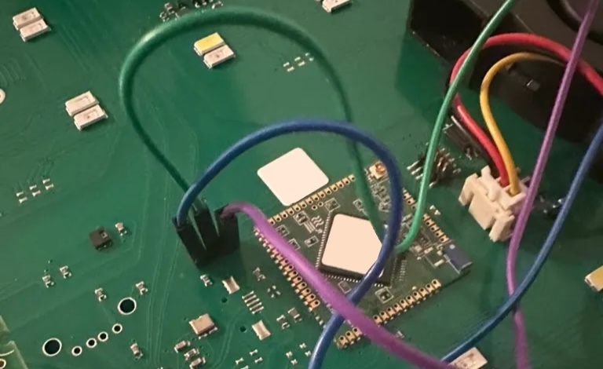
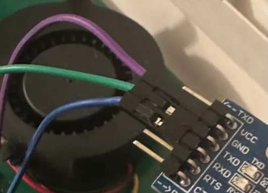

# 01 · Hardware e collegamenti

**Percorso guidato:** [Indice dei capitoli](../index.md)

## Serra Linfa Weezy (VoCore2)

La serra Linfa Weezy è basata su un **VoCore2**, un piccolo modulo embedded con:

- CPU MIPS
- Linux custom (kernel 3.18 + BusyBox)
- gestione diretta di:
    - pannello LED
    - ventole
    - pompe (principale + 3 nutrienti)
    - LED ring RGB
    - rete Wi-Fi integrata

Caratteristiche rilevanti per questo progetto:

- Espone una **console root via UART** (login diretto senza restrizioni).
- Il firmware non viene modificato: tutte le azioni avvengono tramite comandi runtime.
- In assenza del Raspberry esterno, la serra torna al comportamento originale (cloud incluso) ripristinando i permessi sulla cartella var/update e il token.

Nota importante:

- La Wi-Fi della serra **viene disabilitata attivamente dal Raspberry** per motivi di sicurezza.
- Questo non modifica la configurazione stock del VoCore: è una policy applicata dall’esterno.

Maggiori dettagli sul modulo VoCore:
[https://vocore.io/v2.html](https://vocore.io/v2.html)

---

## Raspberry Pi (controller)

Il Raspberry Pi funge da **controller esterno** e da punto di integrazione con MQTT / Home Assistant.

Configurazione utilizzata:

- Modello: **Raspberry Pi 3B**

    (qualsiasi modello con USB standard va bene: 3B, 3B+, 4, Zero 2 W)

- Storage: microSD (≥ 16 GB consigliati)
- Sistema operativo: Raspberry Pi OS (Lite consigliato)

Responsabilità del Raspberry:

- Connessione fisica alla serra tramite USB → UART
- Esecuzione della CLI serra
- Esecuzione del bridge MQTT
- Applicazione delle policy (es. disabilitazione rete serra al boot)
- Pubblicazione stati e comandi su MQTT

Il Raspberry può essere connesso via Ethernet **oppure** via Wi-Fi alla rete domestica

---

## Adattatore USB → TTL 3.3V (FT232, CP2102, CH340)

Per collegarsi alla console UART del VoCore è necessario un **adattatore USB → TTL a 3.3V**.

Chip compatibili e testati comunemente:

- **FTDI FT232RL / FT232-AZ**
- **Silicon Labs CP2102 / CP2104**
- **CH340 / CH341**

Requisiti fondamentali:

- **Livelli logici 3.3V** (NON 5V)
- Esporre almeno:
    - TX
    - RX
    - GND
- Non è necessario collegare VCC

Nota:

- Il VoCore **non deve essere alimentato** dall’adattatore TTL.
- L’adattatore serve solo per la comunicazione seriale.

---

## Cablaggio (TX / RX / GND, note 3.3V)

Collegamenti essenziali:

| **Adattatore USB→TTL** | **Serra (VoCore)** |
| --- | --- |
| TX | RX |
| RX | TX |
| GND | GND |
| VCC | **NON collegare** |

> [!CAUTION]
> Usa solo livelli **3,3 V TTL**: il VoCore non tollera 5 V. **Non collegare VCC.** Collega GND e incrocia TX con RX.

Baudrate console:

- **115200 baud**
- 8N1 (default)



Verifica comunque i pin sulla tua scheda prima di collegare l'adattatore. Tenendo il VoCore a destra, da destra a sinistra i 3 pin sono: GND, Rx, Tx



Nell’adattatore vanno collegati come al solito, GND con GND e Tx e Rx invertiti rispetto al VoCore

---

## Note su /dev/ttyUSB* e compatibilità

Quando l’adattatore USB→TTL viene collegato al Raspberry:

- viene esposto come:
    - /dev/ttyUSB0, /dev/ttyUSB1, …

        **oppure**

    - /dev/ttyACM0 (alcuni CP210x)

Verifica rapida (dal Raspberry):

```bash
ls -l /dev/ttyUSB* /dev/ttyACM*
# Deve restituire qualcosa tipo:
# ls: cannot access '/dev/ttyACM*': No such file or directory
# crw-rw---- 1 root dialout 188, 0 Jan 24 16:17  /dev/ttyUSB0
```

Note di compatibilità:

- FTDI e CP210x sono generalmente più stabili su Linux.
- CH340 funziona correttamente ma può richiedere driver sui sistemi non Linux.
- Il nome del device può cambiare tra reboot: lo script serra usa un path configurabile.

---

## Continua il percorso

> [!TIP]
> **Verifica prima di proseguire:** Hai identificato TX, RX e GND e usi un adattatore TTL a 3,3 V senza collegare VCC.

| Passo precedente | Passo successivo |
| :--- | ---: |
| [← 00 · Panoramica e obiettivi](00-panoramica.md) | [02 · Preparare il Raspberry Pi →](02-raspberry.md) |
