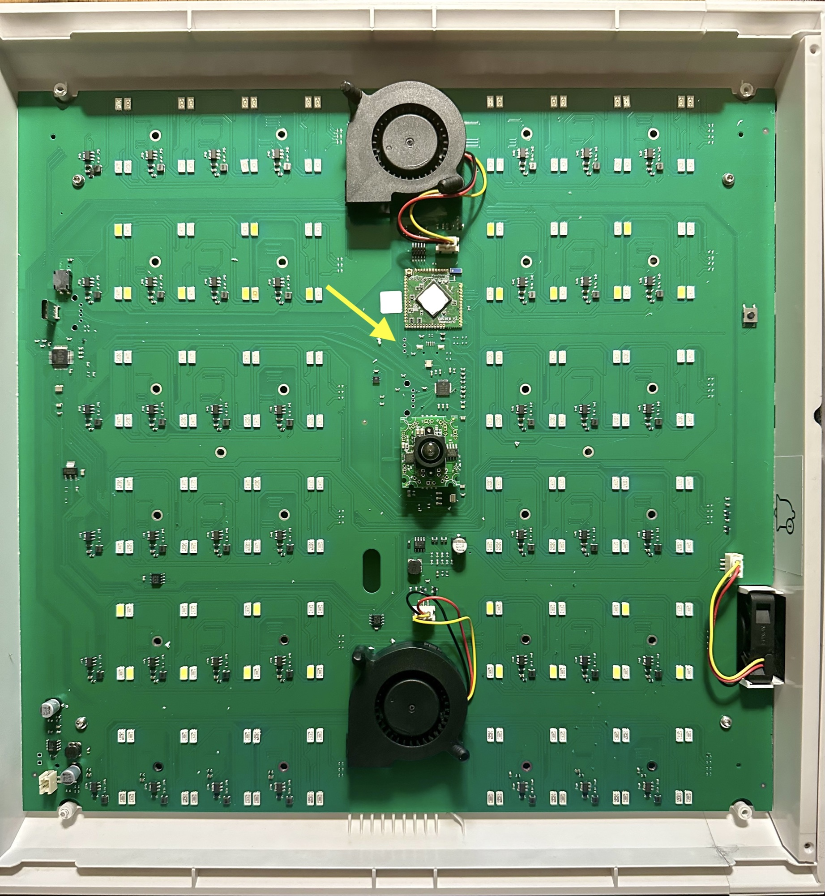
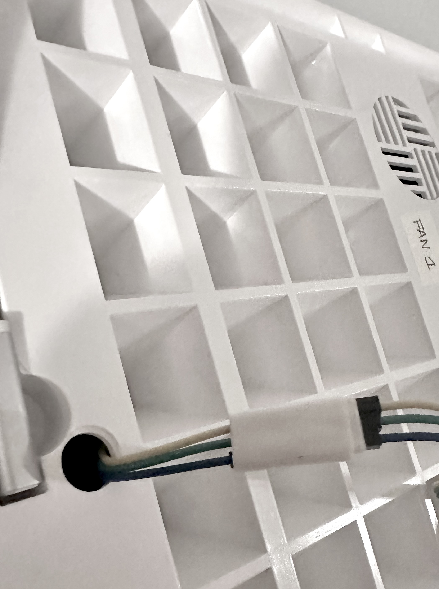

# 01 · Hardware e collegamenti

> [!CAUTION] Prima di toccare la scheda
> **Stacca la spina della serra dalla presa e scollega l'adattatore USB → TTL dal Raspberry/computer.** Fallo prima di aprire la parte superiore, identificare o collegare i pin, saldare e forare. Tieni la scheda e i collegamenti lontani da acqua, serbatoi, tubi e pompe. [Leggi tutte le precauzioni](00-panoramica.md#prima-di-intervenire-sicurezza-elettrica-e-acqua) prima di iniziare.

## La serra Linfa Weezy

La serra è basata su un **VoCore2**, un piccolo modulo con CPU MIPS e Linux personalizzato (kernel 3.18 e BusyBox). È il “cervello” della serra: si trova **nella parte superiore, dove sono le luci**, e gestisce direttamente il pannello LED, le ventole, la pompa principale, le tre pompe dei nutrienti, l’anello LED RGB e la rete Wi-Fi integrata.

<div class="info-grid" markdown="1">
<div class="info-card" markdown="1">
<span class="card-icon" aria-hidden="true">⌘</span>
**Console seriale**

Il modulo espone una console root via UART, usata per comunicare con il Raspberry.
</div>
<div class="info-card" markdown="1">
<span class="card-icon" aria-hidden="true">◇</span>
**Firmware invariato**

Il progetto non modifica il firmware: i comandi sono eseguiti durante il funzionamento.
</div>
</div>

> [!NOTE] Comportamento originale
> Il funzionamento originale, cloud incluso, può essere ripristinato **ripristinando il token e i permessi di `/var/update`**. Quando il controllo locale è in uso, il Raspberry disabilita attivamente la Wi-Fi della serra: è una policy esterna, non una modifica permanente alla configurazione stock del VoCore.

Per i dettagli sul modulo: [specifiche VoCore2](https://vocore.io/v2.html).

## Il Raspberry Pi

Il Raspberry Pi è il **controller esterno** e il punto di integrazione con MQTT e Home Assistant. Può collegarsi alla rete domestica tramite Ethernet o Wi-Fi.

<div class="spec-card" markdown="1">
<div markdown="1"><span>MODELLO USATO</span>**Raspberry Pi 3B**<small>Un 3B+ o 4 con porta USB standard può svolgere lo stesso ruolo. Il Pi Zero 2 W ha una porta micro USB OTG: per collegare un adattatore USB-A serve un adattatore OTG.</small></div>
<div markdown="1"><span>MEMORIA</span>**microSD ≥ 16 GB**<small>Capacità consigliata per il sistema operativo.</small></div>
<div markdown="1"><span>SISTEMA</span>**Raspberry Pi OS**<small>Versione Lite consigliata.</small></div>
</div>

### Il suo ruolo nel sistema

- Comunica con la serra via USB → UART.
- Esegue la CLI `serra` e il bridge MQTT.
- Applica le policy, come la disabilitazione della Wi-Fi della serra all’avvio.
- Pubblica stati e comandi su MQTT.

## L’adattatore USB → TTL

Per accedere alla console UART del VoCore serve un adattatore seriale con **segnali TX/RX a 3,3 V**. Il nome del chip (FT232, CP210x o CH340) da solo non basta: lo stesso chip può essere montato su schede con livelli diversi. Controlla la scheda tecnica del **modello esatto** e l'etichetta dei pin prima di collegarlo.

Ecco il cavo usato nel prototipo e due alternative con livelli dei segnali dichiarati dal produttore:

| Modello | Collegamento | Attenzione |
| --- | --- | --- |
| [DTech FTDI USB → TTL a 3 pin, 3,3 V](https://www.amazon.it/dp/B08L6B6XHN) · **usato nel prototipo** | Cavo USB-A da 1 m con tre terminali femmina separati per TX, RX e GND. [DTech descrive la variante a 3 pin e i livelli a 3,3 V](https://www.dtechelectronics.com/usb-to-ttl-3p-serial-cable_n145). | Controlla che la confezione indichi proprio **3,3 V e tre pin**: DTech vende anche varianti a 5 V. Verifica la funzione di ogni terminale prima di collegarlo. |
| [FTDI TTL-232R-3V3-WE](https://ftdichip.com/products/ttl-232r-3v3-we/) | Cavo USB-A con fili liberi; TXD, RXD e GND utilizzabili per questa UART. | I/O a 3,3 V, ma il filo VCC rosso porta **5 V**: deve rimanere isolato. Verifica i colori nel [datasheet FTDI](https://ftdichip.com/wp-content/uploads/2023/07/DS_TTL-232R_CABLES.pdf). |
| [Adafruit USB to TTL Serial Cable #954](https://www.adafruit.com/product/954) | Cavo USB-A con terminali separati; usa TX, RX e GND. | TX/RX a 3,3 V, ma il filo di alimentazione rosso porta **5 V**: non collegarlo alla serra. |

<div class="photo-grid adapter-gallery" markdown="1">
<figure markdown="1">


<figcaption><span>01</span><strong>DTech a 3 pin · quello usato</strong><small>Foto della <a href="https://www.amazon.it/dp/B08L6B6XHN">scheda prodotto Amazon</a>. Solo TX, RX e GND: non alimenta la serra.</small></figcaption>
</figure>
<figure markdown="1">


<figcaption><span>02</span><strong>Adafruit #954 · alternativa</strong><small>Foto <a href="https://www.adafruit.com/product/954">Adafruit</a>. Usa TX, RX e GND; <strong>isola il filo rosso a 5 V</strong>.</small></figcaption>
</figure>
</div>

Sono esempi di compatibilità **elettrica** dei segnali, non una garanzia che i terminali entrino direttamente nei pin della tua scheda. Il cavo FTDI ha fili liberi; DTech e Adafruit hanno connettori separati. Se usi un adattatore a schedina come quello delle foto più sotto, serve anche un cavo USB adatto alla sua presa: dalla sola foto di quella schedina non è possibile verificarne il livello logico. Se hai un multimetro, verifica anche che il TX dell'adattatore, alimentato via USB ma **non ancora collegato alla serra**, sia circa 3,3 V rispetto a GND a riposo. Per un'installazione stabile controlla spazio disponibile, isolamento e fermacavo.

<div class="requirement-strip"><span class="requirement-label">REQUISITI ESSENZIALI</span><span>3,3 V TTL</span><span>TX</span><span>RX</span><span>GND</span><span class="struck">VCC non collegato</span></div>

> [!CAUTION] Non alimentare il VoCore dall’adattatore
> L’adattatore serve soltanto per la comunicazione seriale. **Non collegare VCC** e non usare livelli logici a 5 V: il VoCore non li tollera.

## Cablaggio UART

**Esegui e modifica questi collegamenti solo con la serra scollegata dalla presa e l'adattatore USB → TTL scollegato dal Raspberry/computer.** Collega la massa in comune e **incrocia TX con RX**. Verifica sempre i pin sulla tua scheda prima di collegare l’adattatore.

<div class="wiring-card" aria-label="Collegamenti tra adattatore USB TTL e serra">
  <div class="wiring-head"><span>ADATTATORE USB → TTL</span><span>SERRA · VOCORE2</span></div>
  <div class="wiring-row"><span><b>TX</b></span><span class="wire-line" aria-hidden="true">↗</span><span><b>RX</b></span></div>
  <div class="wiring-row"><span><b>RX</b></span><span class="wire-line" aria-hidden="true">↘</span><span><b>TX</b></span></div>
  <div class="wiring-row"><span><b>GND</b></span><span class="wire-line" aria-hidden="true">⟶</span><span><b>GND</b></span></div>
  <div class="wiring-row is-disconnected"><span><b>VCC</b></span><span class="wire-line" aria-hidden="true">×</span><span><b>NON COLLEGARE</b></span></div>
</div>

<div class="serial-settings"><span><small>VELOCITÀ</small><strong>115200 baud</strong></span><span><small>FORMATO</small><strong>8N1</strong></span><span><small>LIVELLI LOGICI</small><strong>3,3 V TTL</strong></span></div>

### Montaggio definitivo: fili saldati e uscita seriale

Nel prototipo documentato qui, i tre collegamenti seriali sono stati **saldati nella parte superiore della serra**. I fili del collegamento con l'adattatore USB → TTL escono dalla scocca attraverso **un foro**. I cavetti Dupont sono comodi per identificare i segnali e fare una prova, ma per un uso continuativo i collegamenti devono restare fermi, isolati e protetti da trazione.

**Prima di saldare o forare, stacca la spina della serra e scollega l'adattatore USB → TTL dal Raspberry/computer.** Tieni la parte superiore su una superficie asciutta, lontana da serbatoi, tubi, pompe e possibili gocce. Verifica la posizione dei componenti all'interno della scocca; non scegliere il punto del foro basandoti soltanto sulle foto, perché la disposizione interna può variare. **Prima di richiudere la parte superiore**, controlla che ciascun collegamento sia ben saldo e isolato, che non ci siano cortocircuiti tra TX, RX e GND e che il bordo del foro non possa tagliare il cavo. **VCC resta sempre scollegato.**

La foto d'insieme mostra la scheda nella parte superiore della serra: **la freccia gialla indica la zona dei pin UART**. Le due foto successive mostrano il dettaglio dei pin con i cavetti collegati e la schedina adattatrice usata nelle prove. L'ultima foto mostra il passaggio dei fili attraverso la scocca. Non è disponibile una foto ravvicinata delle saldature: verifica i punti TX, RX e GND sulla tua scheda prima di procedere.

<div class="photo-grid board-overview" markdown="1">
<figure markdown="1">



<figcaption><span>01</span><strong>Dove si trovano i pin UART</strong><small>Vista d'insieme della scheda nella parte superiore della serra. La freccia gialla indica i pin mostrati nel dettaglio qui sotto.</small></figcaption>
</figure>
</div>

<div class="photo-grid" markdown="1">
<figure markdown="1">


<figcaption><span>02</span><strong>Pin seriali sulla serra</strong><small>Con il VoCore a destra, i pin da destra a sinistra sono GND, RX e TX. Verificali sulla tua scheda.</small></figcaption>
</figure>
<figure markdown="1">


<figcaption><span>03</span><strong>Adattatore USB → TTL</strong><small>GND va a GND; TX e RX vanno incrociati rispetto al VoCore.</small></figcaption>
</figure>
</div>

<figure class="installation-photo" markdown="1">



<figcaption>04 · Uscita dei tre fili dalla parte superiore della serra. Il punto e le dimensioni del foro vanno scelti in base allo spazio effettivo nella propria scocca.</figcaption>
</figure>

## Verifica la porta seriale

**Solo dopo aver terminato il montaggio, isolato i fili, verificato che tutto sia asciutto e richiuso la scocca**, puoi ricollegare l'adattatore al Raspberry e alimentare la serra per la prova. Una volta collegato l’adattatore al Raspberry, il dispositivo compare di solito come `/dev/ttyUSB0`, `/dev/ttyUSB1` o, con alcuni adattatori, `/dev/ttyACM0`.

Verifica dal Raspberry:

```bash
ls -l /dev/ttyUSB* /dev/ttyACM*
```

È normale che uno dei due pattern non trovi alcun dispositivo: l’altro deve mostrare una porta seriale, ad esempio `/dev/ttyUSB0`. Il nome può cambiare tra riavvii; lo script `serra` usa un percorso configurabile.

> [!TIP] Note di compatibilità
> FTDI e CP210x sono generalmente più stabili su Linux. CH340 funziona correttamente, ma può richiedere driver sui sistemi non Linux.

## Continua il percorso

> [!TIP] Controllo
> **Verifica prima di proseguire:** Hai identificato TX, RX e GND e usi un adattatore TTL a 3,3 V senza collegare VCC.

<table width="100%" class="step-nav">
  <tr>
    <td width="50%" align="left"><strong>Passo precedente</strong><br><a href="00-panoramica.md">← 00 · Panoramica e obiettivi</a></td>
    <td width="50%" align="right"><strong>Passo successivo</strong><br><a href="02-raspberry.md">02 · Preparare il Raspberry Pi →</a></td>
  </tr>
</table>
