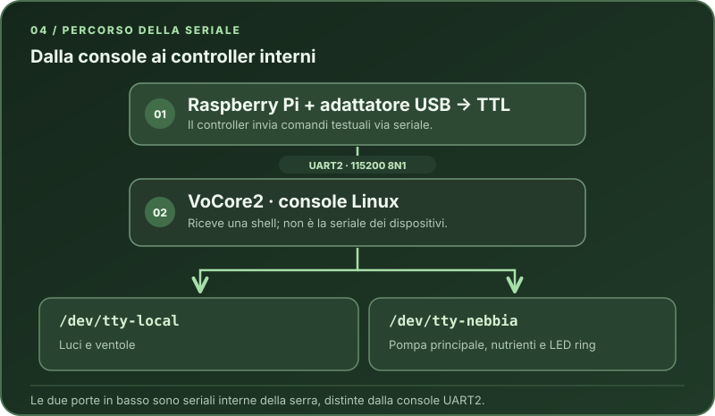

# 04 · Verificare la console UART

**Percorso guidato:** [Indice dei capitoli](../index.md)

Prima di eseguire **qualsiasi comando di controllo**, script o policy, è fondamentale verificare che il collegamento UART tra Raspberry e serra funzioni correttamente.

Questa è una **prova con alimentazione**: avviala soltanto dopo aver completato e isolato il cablaggio, richiuso la parte superiore e verificato che elettronica, cavi e alimentatori siano asciutti e lontani da acqua, serbatoi, tubi e pompe. Se devi correggere un collegamento, **scollega prima la spina della serra e l'adattatore USB → TTL dal Raspberry/computer**; non spostare i fili mentre il sistema è alimentato.

Questa verifica:

- non modifica nulla sulla serra
- non dipende dalla rete Wi-Fi
- è il metodo più affidabile per diagnosticare problemi futuri

## Dove passano i comandi



*UART2 è la console Linux del VoCore2. `/dev/tty-local` e `/dev/tty-nebbia` sono invece due porte interne distinte: il controller le usa per raggiungere luci, ventole, pompe e LED ring.*

---

## Apertura console UART con picocom

Dal Raspberry, collegato via SSH:

```bash
picocom -b 115200 /dev/ttyUSB0
```

Note:

- 115200 è il baudrate corretto per la console VoCore2
- il device può essere `/dev/ttyUSB0` o `/dev/ttyUSB1` a seconda dell’adattatore
- se il comando rimane “vuoto”, **accendere o riavviare la serra**

Durante il boot della serra dovresti vedere:

- log del kernel
- inizializzazione BusyBox
- messaggio finale simile a: `Welcome to Buildroot`

Se vedi il boot, hai verificato la **ricezione** dal VoCore verso il Raspberry. Il solo log non prova che il VoCore riceva i tuoi caratteri: il login e i comandi di verifica qui sotto controllano anche il percorso di **trasmissione**.

---

## Login sulla serra via UART

Comportamento atteso:

- Riavviando la serra si vede il boot log
- A fine boot compare:

    `Welcome to Buildroot`

- Login:
    - user: `root`
    - password: quella di default dovrebbe essere vuota, oppure: `vocore`

Più avanti imposterai una password scelta da te per la serra. Qui `<DEVICE_PASSWORD>` indica quella password se è già stata cambiata.

Alla richiesta di login, inserire `root`

Password: Se la serra non è stata ancora modificata: lasciare vuoto (premere solo INVIO) o provare `vocore`. Se la password è già stata cambiata: `<DEVICE_PASSWORD>`

Se il login va a buon fine, ci si trova **dentro la serra**, senza passare da Wi-Fi o cloud.

> [!CAUTION] Attenzione
> La console dà accesso root diretto alla serra. In questo passo usa solo i comandi di verifica e non modificare i file di sistema.

---

## Comandi minimi di verifica

Una volta loggati, eseguire solo comandi **non distruttivi**:

```bash
uname -a
```

**Risposta attesa:** una riga simile a `Linux buildroot 3.18.29 #1 Thu May 16 10:06:29 UTC 2019 mips GNU/Linux`. Data e versione possono differire.

Verifica:

- kernel Linux (3.18.x)
- architettura MIPS (VoCore2)

```bash
uptime
```

**Risposta attesa:** una riga simile a `09:06:53 up 1:24, 0 users, load average: 0.03, 0.02, 0.05`. Orario, durata e carico cambiano.

Serve per:

- confermare che la shell risponde correttamente
- verificare eventuali reboot inattesi

```bash
ls /
```

**Risposta attesa:** una lista di directory, per esempio `bin`, `dev`, `etc`, `lib`, `linuxrc`, `mnt`, `opt`, `proc`, `root`, `sbin`, `sys`, `tmp`, `usr`, `var`. Il contenuto preciso dipende dal firmware.

Controllo rapido della struttura filesystem (rootfs minimale BusyBox).

⚠️ **Non modificare nulla in questa fase.**

Questa sezione serve solo a confermare che:

- UART funziona
- console è stabile
- credenziali sono corrette

---

## Uscita da picocom

Per uscire correttamente:

Premi **CTRL + A**, poi **CTRL + X**.

Se la console non risponde:

- verifica di non aver perso il focus
- in casi estremi, chiudi la sessione SSH

---

## Stato atteso al termine

- ✅ Ricezione e trasmissione UART verificate tramite login e comandi
- ✅ Accesso root verificato
- ✅ Nessuna modifica persistente sulla serra
- ✅ Pronti per il controllo esterno via Raspberry

Nel passo 05 userai ancora la console per impostare la password root della serra. Poi il controller sul Raspberry invierà i comandi via UART.

---

## Continua il percorso

> [!TIP] Controllo
> **Verifica prima di proseguire:** La console risponde, puoi effettuare il login e il comando di prova funziona.

<table width="100%" class="step-nav">
  <tr>
    <td width="50%" align="left"><strong>Passo precedente</strong><br><a href="03-raspberry.md">← 03 · Preparare il Raspberry Pi</a></td>
    <td width="50%" align="right"><strong>Passo successivo</strong><br><a href="05-password-root.md">05 · Impostare la password root →</a></td>
  </tr>
</table>
