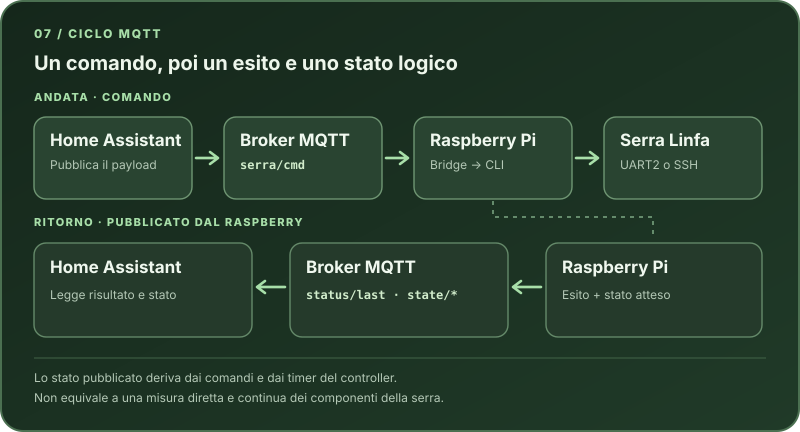

# 07 · Configurare il bridge MQTT

**Percorso guidato:** [Indice dei capitoli](../index.md)

Prosegui dopo aver verificato il controller CLI nel passo 06. Qui configuri il broker, il servizio e una prova MQTT completa.

## Come viaggia un comando



*Il messaggio di ritorno è pubblicato dal Raspberry: include l'esito del comando e lo stato **atteso** ricavato dal controller, non una misura continua dei dispositivi nella serra. La [tabella dei comandi](../riferimento-comandi.md) mostra le forme equivalenti per Raspberry e Home Assistant.*

## Prima di configurare il bridge: broker MQTT

### Broker MQTT

È necessario un broker MQTT raggiungibile sia da:

- Raspberry
- Home Assistant

Soluzioni tipiche:

- App ufficiale Mosquitto Broker in Home Assistant, se usi Home Assistant OS
- Broker MQTT esterno (NAS, server Linux)

Requisiti minimi:

- porta 1883
- autenticazione user/password
- supporto messaggi retained

Se non hai ancora un broker e usi **Home Assistant OS**:

1. Vai in **Impostazioni → App → Installa app**, installa **Mosquitto broker**, avvialo e controlla che il suo log non mostri errori.
2. Crea un utente dedicato per il Raspberry in **Impostazioni → Persone → Utenti** (attiva la modalità avanzata nel profilo se la voce non compare). Non usare i nomi riservati `homeassistant` o `addons`. In alternativa puoi creare un login locale nelle opzioni dell'app Mosquitto.
3. Verifica che la porta MQTT `1883/tcp` dell'app sia esposta alla rete locale. Come `<BROKER_IP>` usa l'indirizzo di rete di Home Assistant raggiungibile dal Raspberry, non il nome interno `core-mosquitto.local.hass.io`.

Le [istruzioni ufficiali dell'app Mosquitto](https://github.com/home-assistant/addons/blob/master/mosquitto/DOCS.md) descrivono installazione, utenti e porte. Se usi Home Assistant con un metodo diverso da OS, installa un broker MQTT separato e usa il suo indirizzo e le sue credenziali.

---

### Credenziali MQTT

Il Raspberry deve avere credenziali valide per il broker in `/etc/serra-mqtt.env`. Home Assistant deve collegarsi **allo stesso broker**, ma può usare credenziali diverse. Se utilizzi l'app ufficiale Mosquitto Broker di Home Assistant, l'integrazione MQTT può configurare automaticamente il proprio accesso; crea comunque un account MQTT per il Raspberry nelle opzioni del broker.

Nel seguito, `<BROKER_IP>`, `<MQTT_USER>` e `<MQTT_PASSWORD>` indicano l'indirizzo e le credenziali del tuo broker; la porta usata negli esempi è `1883`.

---

## Creazione file /etc/serra-mqtt.env

> [!CAUTION] Attenzione
> `/etc/serra-mqtt.env` contiene le credenziali MQTT. La password della console della serra resta nel file privato creato con `serra auth save` al passo 06. Non caricare nessuno dei due file nella repository o nelle issue.

Puoi partire dal [modello senza credenziali](https://github.com/Interstellar0verdrive/Linfa-local-control/blob/main/bridge/serra-mqtt.env.example).

```bash
if [ ! -e /etc/serra-mqtt.env ]; then sudo install -m 600 /dev/null /etc/serra-mqtt.env; fi
sudo nano /etc/serra-mqtt.env
```

Contenuto (l'indirizzo e le credenziali MQTT sono quelli del broker):

```text {.file-content}
SERRA_MQTT_HOST=<BROKER_IP>
SERRA_MQTT_PORT=1883
SERRA_MQTT_USER=<MQTT_USER>
SERRA_MQTT_PASS=<MQTT_PASSWORD>
SERRA_MQTT_TOPIC=serra
SERRA_CLI=/usr/local/bin/serra
SERRA_UART_LOCK_TIMEOUT=60
SERRA_CMD_TIMEOUT=120
SERRA_MQTT_CONNECT_TIMEOUT=4
```

Se la seriale non è `/dev/ttyUSB0`, aggiungi `SERRA_UART_PORT=/dev/ttyUSB1` sostituendo il percorso con quello trovato sul tuo Raspberry. `SERRA_UART_LOCK_TIMEOUT=60` è il valore usato sul prototipo: lascia tempo ai comandi concorrenti di aspettare la UART. Il bridge interrompe i comandi dopo `SERRA_CMD_TIMEOUT` secondi e limita a `SERRA_MQTT_CONNECT_TIMEOUT` secondi la verifica di raggiungibilità del broker. Se una password contiene spazi, apici o barre inverse, scrivila secondo la [sintassi dei file `EnvironmentFile`](https://www.freedesktop.org/software/systemd/man/latest/systemd.exec.html#EnvironmentFile=): non copiare letteralmente i segnaposto tra `<` e `>`.

Permessi:

```bash
sudo chown root:root /etc/serra-mqtt.env
sudo chmod 600 /etc/serra-mqtt.env
```

Verifica i permessi senza stampare le credenziali: `sudo stat -c '%a %U:%G' /etc/serra-mqtt.env` deve mostrare `600 root:root`.

---

## Service systemd: MQTT Bridge

Avvia e mantiene in esecuzione serra_mqtt_bridge.py (subscriber su serra/cmd → invoca CLI serra ... → pubblica serra/status/* + stati via controller).

È configurato con Restart=always per resilienza.

### File service

Nel passo 06 hai già copiato il [file pronto del servizio](https://github.com/Interstellar0verdrive/Linfa-local-control/blob/main/bridge/systemd/serra-mqtt-bridge.service) in `/home/pi/`. Installalo:

**Se l'utente del Raspberry non è `pi`:** prima di installare il file, modifica la copia nella tua home sostituendo `User=pi` e `/home/pi/serra_mqtt_bridge.py` con l'utente e il percorso effettivi. Usa lo stesso utente con cui hai eseguito `serra auth save` e adatta anche il percorso nel comando seguente.

```bash
sudo install -m 644 /home/pi/serra-mqtt-bridge.service /etc/systemd/system/
```

Il contenuto del file è:

```ini {.file-content}
[Unit]
Description=Serra MQTT Bridge
After=network-online.target
Wants=network-online.target

[Service]
Type=simple
User=pi
EnvironmentFile=/etc/serra-mqtt.env
ExecStart=/usr/bin/python3 /home/pi/serra_mqtt_bridge.py
Restart=always
RestartSec=5

[Install]
WantedBy=multi-user.target
```

### Enable e start

```bash
sudo systemctl daemon-reload
sudo systemctl enable --now serra-mqtt-bridge.service
```

Verifica:

```bash
systemctl status serra-mqtt-bridge.service --no-pager
journalctl -u serra-mqtt-bridge.service -n 100 --no-pager
```

**Risposta attesa:** `systemctl status` indica `Loaded: loaded` e `Active: active (running)`; il log mostra l'avvio del bridge senza errori. PID, date e altri dettagli cambiano a ogni installazione.

---

## Verifica MQTT end-to-end

### Stato bridge

Il bridge pubblica:

```text {.reference-example}
serra/status/online
serra/status/last_seen
```

Verifica:

```bash
mosquitto_sub -h <BROKER_IP> -u <MQTT_USER> -P '<MQTT_PASSWORD>' -t "serra/status/#" -v
```

**Risposta attesa:** una riga che comincia con `serra/status/online` seguita da un messaggio JSON con `"ok": true` e `"msg": "bridge online"`. Altri campi possono variare.

Per uscire: `CTRL + C`

### Comando via MQTT

Accendi le luci con una dissolvenza di 3 secondi:

```bash
mosquitto_pub -h <BROKER_IP> -u <MQTT_USER> -P '<MQTT_PASSWORD>' \
  -t serra/cmd -m "lights on -f 3"
```

Poi spegnile:

```bash
mosquitto_pub -h <BROKER_IP> -u <MQTT_USER> -P '<MQTT_PASSWORD>' \
  -t serra/cmd -m "lights off"
```

Verifica che lo stato venga aggiornato su `serra/state/...`:

```bash
mosquitto_sub -h <BROKER_IP> -u <MQTT_USER> -P '<MQTT_PASSWORD>' -t "serra/status/last" -v
```

**Risposta attesa:** il topic `serra/status/last` seguito da un JSON con `"ok": true`, `"rc": 0` e `"cmd": ["lights", "off"]` se l'ultimo comando è stato quello di spegnimento. I timestamp e gli altri campi cambiano a ogni esecuzione.

Controlla anche **le luci della serra**: `ok` conferma che il comando è stato accettato dalla console, non fornisce un riscontro hardware indipendente. Se l'esito è incerto, verifica lo stato fisico prima di ripetere un comando che aziona pompe o altri componenti.

Per uscire: `CTRL + C`

---

## Continua il percorso

> [!TIP] Controllo
> **Verifica prima di proseguire:** Il servizio bridge è attivo e i topic di stato e comando rispondono.

<table width="100%" class="step-nav">
  <tr>
    <td width="50%" align="left"><strong>Passo precedente</strong><br><a href="06-controller-cli.md">← 06 · Installare il controller CLI</a></td>
    <td width="50%" align="right"><strong>Passo successivo</strong><br><a href="08-servizi-automatici.md">08 · Attivare i servizi automatici →</a></td>
  </tr>
</table>
